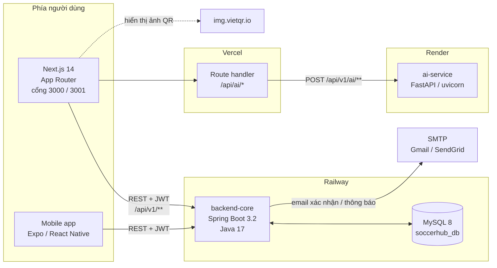
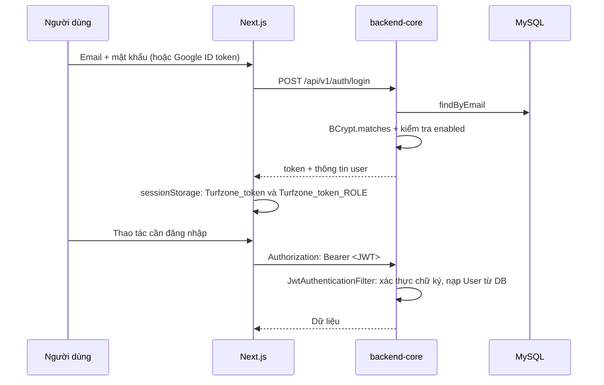
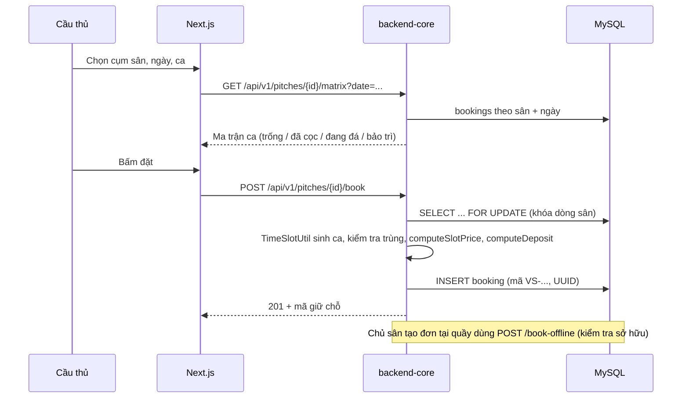
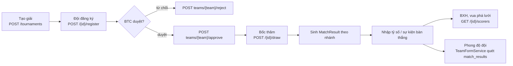

# Kiến Trúc Hệ Thống — Turfzone

Tài liệu này mô tả **cách hệ thống được lắp ghép**: các dịch vụ, ranh giới trách nhiệm, luồng dữ liệu, mô hình bảo mật và những quyết định kiến trúc đang có trong mã nguồn. Mọi mô tả ở đây đều đối chiếu với code tại thời điểm viết; khi code thay đổi, tài liệu phải được cập nhật theo.

- Sản phẩm: **Turfzone** — nền tảng quản lý sân bóng và giải đấu.
- Mã nguồn: monorepo tại thư mục `SoccerHub` (tên thư mục và tên sản phẩm khác nhau; trong code, package Java là `com.turfzone`, tên CSDL mặc định là `soccerhub_db`).

## Mục lục

1. [Bộ tài liệu và cách đọc](#1-bộ-tài-liệu-và-cách-đọc)
2. [Sơ đồ tổng thể](#2-sơ-đồ-tổng-thể)
3. [Thành phần và trách nhiệm](#3-thành-phần-và-trách-nhiệm)
4. [Luồng dữ liệu chính](#4-luồng-dữ-liệu-chính)
5. [Mô hình bảo mật](#5-mô-hình-bảo-mật)
6. [Tính nhất quán dữ liệu](#6-tính-nhất-quán-dữ-liệu)
7. [Tính "realtime"](#7-tính-realtime)
8. [Triển khai và vận hành](#8-triển-khai-và-vận-hành)
9. [Nhật ký quyết định kiến trúc](#9-nhật-ký-quyết-định-kiến-trúc)
10. [Nợ kỹ thuật và rủi ro](#10-nợ-kỹ-thuật-và-rủi-ro)
11. [Bản đồ mã nguồn](#11-bản-đồ-mã-nguồn)
12. [Đọc tiếp](#12-đọc-tiếp)

---

## 1. Bộ tài liệu và cách đọc

| Tài liệu | Trả lời câu hỏi | Đối tượng |
|---|---|---|
| [README.md](../README.md) | Chạy thử trong 5 phút, tài khoản demo, phân hệ chính | Người mới, giảng viên phản biện |
| **ARCHITECTURE.md** (file này) | Hệ thống gồm những gì, nói chuyện với nhau ra sao, bảo mật thế nào | Kỹ sư, người review |
| [API.md](./API.md) | 131 endpoint: method, path, quyền, tham số, lỗi | Lập trình viên backend/frontend |
| [DATABASE.md](./DATABASE.md) | 18 `@Entity` + 1 `@Embeddable`, quan hệ, quy tắc nghiệp vụ tầng dữ liệu | Backend, người thiết kế CSDL |
| [FRONTEND.md](./FRONTEND.md) | Route, tầng service, state, component, design system | Frontend |
| [AI-SERVICE.md](./AI-SERVICE.md) | Hai thuật toán gợi ý sân và ghép kèo | Người làm phần AI |
| [DEPLOYMENT.md](./DEPLOYMENT.md) | Biến môi trường, Railway/Vercel/Render, xử lý sự cố | DevOps, người vận hành |

Thứ tự đọc gợi ý: README → ARCHITECTURE (chương 2–4) → tài liệu của phần mình phụ trách.

---

## 2. Sơ đồ tổng thể



Điểm quan trọng trong sơ đồ:

- **Trình duyệt không gọi trực tiếp AI service.** Nó gọi route handler nội bộ `/api/ai/[slug]` của Next.js, route này mới chuyển tiếp sang FastAPI. Lý do: tránh CORS trên mobile và giấu URL nội bộ (`frontend/src/app/api/ai/[...slug]/route.ts`).
- **Chỉ backend-core nói chuyện với MySQL.** AI service không có CSDL, không lưu trạng thái; frontend không truy vấn DB.
- **Backend không gọi AI service** ở thời điểm hiện tại, dù `application.yml` có khai báo `ai-service.url`. Thuộc tính này chưa được dùng ở đâu trong code.

---

## 3. Thành phần và trách nhiệm

### 3.1 Bảng tổng hợp

| Thành phần | Công nghệ thực tế (theo manifest) | Cổng | Thư mục | Trách nhiệm |
|---|---|---|---|---|
| Backend Core | Spring Boot 3.2.3, Java **17** (`pom.xml`), Spring Web/JPA/Security, JJWT 0.11.5, JavaMail, google-api-client 2.2.0, Lombok, MySQL Connector/J, H2 (runtime) | `${PORT:8080}` | `backend-core/` | Nguồn sự thật duy nhất: xác thực, đặt sân, giải đấu, cộng đồng, chat, căn tin, báo cáo, quản trị |
| AI Service | FastAPI, uvicorn, Pydantic v2 | `8000` (Render gán `$PORT`) | `ai-service/` | Chấm điểm gợi ý cụm sân; ghép kèo theo phong độ. Hàm thuần, không I/O |
| Frontend | Next.js 14.1 (App Router), React 18, TypeScript 5.3, Tailwind 3.4, Framer Motion 11, Recharts, jsPDF, html-to-image | `3000` (và `3001` khi dev song song) | `frontend/` | Toàn bộ UI cho 4 vai trò + trang quản trị + trang giới thiệu |
| Mobile app | Expo + React Native, một màn hình chính trong `App.tsx` | — | `mobile-app/` | Bản di động tối giản dùng chung API |

> [!NOTE]
> Tài liệu cũ (và một số comment) ghi Java 21. Manifest `backend-core/pom.xml` khai báo `<java.version>17</java.version>`, CI dùng JDK 17 và `nixpacks.toml` đặt `NIXPACKS_JDK_VERSION=17`. Con số đúng là **17**.

### 3.2 Backend Core — cấu trúc package

| Package | Nội dung | Ghi chú |
|---|---|---|
| `com.turfzone` | `TurfzoneApplication` | Trước khi Spring khởi động: chuẩn hóa `MYSQL_URL`/`DATABASE_URL` của Railway sang JDBC, kiểm tra TCP tới MySQL 5 lần, có thể fallback H2 in-memory |
| `controller` | 16 controller, 131 mapping | Business logic nằm phần lớn **ngay trong controller**, không phải service layer |
| `service` | `AuthService`, `PitchService`, `TeamFormService`, `EmailService`, `GoogleAuthService`, `NotificationService`, `AdminAuditService` | Chỉ một phần logic được tách ra |
| `repository` | 18 Spring Data JPA repository | Có query dẫn xuất và `@Query`; `PitchRepository.findByIdForUpdate` dùng khóa bi quan |
| `model` | 18 `@Entity` + 1 `@Embeddable` (`TournamentTeamEntry`) + enum `UserRole` | Quan hệ chủ yếu bằng `tournamentId`, `pitchId`… (khóa ngoại logic, không phải `@ManyToOne`) |
| `security` | `SecurityConfig`, `JwtAuthenticationFilter`, `JwtTokenProvider` | Stateless, HS256, không session, không refresh token |
| `dto` | 7 request/response DTO | Phần lớn controller nhận/trả `Map<String, Object>` thay vì DTO |
| `util` | `RevenueUtil`, `TimeSlotUtil` | Hai hàm dùng chung quan trọng: công thức doanh thu và sinh ma trận ca |
| `config` | `DataInitializer`, `DatabaseKeepAliveScheduler`, `DataSourceStartupRetry` | Seed dữ liệu demo, giữ kết nối MySQL cloud không ngủ, retry khi DB chưa lên |

Đặc điểm cấu trúc đáng lưu ý:

- **Controller "dày"**: `PitchBookingController` 1.638 dòng, `TournamentController` 2.103 dòng. Đây là nơi chứa cả validate, phân quyền sở hữu, tính giá, sinh mã, gửi thông báo.
- **Không có tầng DTO đầy đủ**: response trả entity trực tiếp hoặc `Map`, nên thay đổi schema entity có thể lộ ra API (xem [API.md](./API.md)).
- **Entity dùng khóa ngoại kiểu số thay vì quan hệ JPA** (ví dụ `Booking.pitchId` là `Long`), trừ một số ít chỗ. Vì vậy tính toàn vẹn tham chiếu do code đảm bảo, không do CSDL.

### 3.3 AI Service

Hai module thuần Python, không phụ thuộc CSDL:

- `recommendation.py` — trọng số 40% khoảng cách (haversine, ngưỡng 20 km), 25% ngân sách, 20% loại sân, 15% đánh giá; chuẩn hóa mã sân `PITCH_*` → `SAN_*`.
- `form_matchmaking.py` — lọc theo chênh lệch tỷ lệ thắng, chấm điểm theo chuỗi phong độ.

Chi tiết công thức: [AI-SERVICE.md](./AI-SERVICE.md).

### 3.4 Frontend

Một ứng dụng Next.js phục vụ **bốn vai trò** trong cùng codebase, chuyển vai trò bằng tab và bằng token lưu theo từng role:

- Route chính `/` là ứng dụng một trang, điều hướng bằng state `activeTab` (Đặt sân, Chợ kèo, Giải đấu, Vé của tôi, Hồ sơ, Quản lý cụm sân, Thẻ thành viên…).
- Route riêng: `/admin`, `/tournaments/new`, `/tournaments/register`, `/notifications`, `/player-setup`.
- Dev chạy hai tiến trình (`run.bat`): cổng 3000 cho chủ sân/admin, cổng 3001 cho cầu thủ, mỗi tiến trình có `distDir` riêng (`.next-3000`, `.next-3001`) nhờ `next.config.js` đọc `process.env.PORT`.

Chi tiết route, component và tầng dữ liệu: [FRONTEND.md](./FRONTEND.md).

### 3.5 Hạ tầng phụ trợ

| Thành phần | Cách dùng hiện tại | Rủi ro |
|---|---|---|
| MySQL | CSDL duy nhất, Hibernate `ddl-auto=update` | Không có công cụ migration; schema tiến hóa theo entity, SQL sửa tay trong `db_migration_new.sql` |
| Lưu file | Ghi vào thư mục `uploads/chat/yyyy/MM/dd` trên filesystem của container backend | Trên Railway filesystem là tạm: redeploy là mất ảnh/tệp chat |
| SMTP | `JavaMailSender`, mặc định tắt (`MAIL_ENABLED=false`) | Thiếu biến môi trường thì email im lặng thất bại, chỉ log |
| VietQR | Frontend tự dựng URL ảnh từ số tài khoản ngân hàng, tải từ `img.vietqr.io` | Không có đối soát tự động; số tài khoản phải sạch ký tự |
| H2 | Fallback in-memory khi không có cấu hình MySQL trên mây | Dữ liệu mất khi restart; chỉ để service mở được cổng cho healthcheck |

---

## 4. Luồng dữ liệu chính

### 4.1 Đăng nhập và phiên



Điểm cần nhớ:

- Token **không chứa quyền có hiệu lực**: filter đọc `role` trong token nhưng quyền thực tế lấy từ `user.getRole()` trong DB, nên đổi vai trò có hiệu lực ngay ở request kế tiếp.
- Tài khoản bị khóa (`enabled=false`) bị từ chối ngay cả khi token còn hạn (`JwtAuthenticationFilter`).
- Không có refresh token: hết 24 giờ (`jwt.expiration: 86400000`) là phải đăng nhập lại.
- Token nằm trong `sessionStorage`, không phải cookie `HttpOnly` — đóng tab là mất phiên, và token đọc được bằng JavaScript.

### 4.2 Đặt sân



Các bất biến đang được bảo vệ trong code (chi tiết ở [DATABASE.md](./DATABASE.md)):

- Một ca chỉ bán một lần: khóa bi quan `findByIdForUpdate` **trước** khi nạp entity, cộng `@Transactional`; vi phạm ràng buộc duy nhất được bắt và trả 400 thay vì 500.
- Giá hiển thị bằng giá thu: cả hai endpoint dùng chung `computeSlotPrice()`; mức cọc do server tính, không tin client.
- Mã đơn sinh bằng UUID, không dùng `millis % 10000` như bản cũ.
- Khách tự hủy vé và chủ sân hủy đơn là hai endpoint khác nhau, kiểm tra quyền khác nhau.

### 4.3 Giải đấu: đăng ký → duyệt → bốc thăm → nhập kết quả



- Bốc thăm seed theo **thứ tự đăng ký**, không dùng hạt giống ngẫu nhiên.
- Phong độ **không lưu điểm**: mỗi lần đọc, `TeamFormService` quét `match_results`, lấy 5 trận gần nhất, ký tự đầu là trận mới nhất.
- Trạng thái giải và nhánh đấu là dữ liệu suy ra từ `MatchResult`, không có bảng "bracket" riêng.

### 4.4 Gợi ý sân / ghép kèo bằng AI

1. Frontend có sẵn danh sách cụm sân (từ backend) và vị trí/ngân sách người dùng.
2. Gọi `POST /api/ai/recommend-pitches` (route handler Next.js) → chuyển tiếp `POST http://ai-service:8000/api/v1/ai/recommend-pitches`.
3. Route handler chỉ cho phép đúng 2 đường dẫn, giới hạn body 256 KB, timeout 55 giây (chịu cold start của Render), trả 502/503/504 rõ ràng thay vì treo.
4. Nếu AI service chết, UI vẫn hoạt động: danh sách sân mặc định không phụ thuộc AI.

### 4.5 Chat cộng đồng và chat nhóm

- Tin nhắn lưu ở `ChatMessage`; tệp đính kèm ghi xuống `uploads/chat/...` và phục vụ qua `GET /api/v1/chat/files/{filename}` (được `permitAll`).
- Không có WebSocket/SSE: client **poll** danh sách tin nhắn theo chu kỳ (4 giây cho kênh công khai, 8 giây cho danh sách nhóm).
- Cảm xúc, ghim, đánh dấu đã đọc là các bảng riêng (`ChatReaction`, `ChatGroupMember.lastReadAt`).

---

## 5. Mô hình bảo mật

### 5.1 Cơ chế

| Hạng mục | Thực tế trong code |
|---|---|
| Thuật toán | JWT HS256, subject = email, claim `role` (chỉ để hiển thị; quyền lấy từ DB) |
| Nơi ký | `JwtTokenProvider`, secret từ `JWT_SECRET`, fallback hard-code khi thiếu biến |
| Thời hạn | 24 giờ, không refresh, không thu hồi (trừ khi khóa tài khoản) |
| Phiên | Stateless, `SessionCreationPolicy.STATELESS`, CSRF tắt |
| Lưu phía client | `sessionStorage` với khóa `Turfzone_token` và `Turfzone_token_<ROLE>` |
| Định danh người dùng | `@AuthenticationPrincipal User` — nạp nguyên entity từ DB mỗi request |
| Mật khẩu | BCrypt |
| Google | `GoogleIdTokenVerifier` xác thực ID token ở server (`GoogleAuthService`), tắt nếu thiếu `GOOGLE_CLIENT_ID` |

### 5.2 Phân quyền ba lớp

1. **Lớp URL** (`SecurityConfig`): `permitAll` cho `/`, `/health`, `/api/v1/health`, `/api/v1/auth/**`, `/h2-console/**`, `/error`, `/api/v1/chat/files/**`, và toàn bộ `/api/v1/pitches/**`, `/api/v1/tournaments/**`, `/api/v1/community/**`. Mọi URL khác cần đăng nhập.
2. **Lớp method/class** (`@PreAuthorize`): 4 vai trò `PLAYER`, `OWNER`, `ORGANIZER`, `ADMIN`. Một số controller đặt annotation ở cấp class (`AdminController`, `AdminManageController`, `OwnerAdminController`, `ChatGroupController`).
3. **Lớp sở hữu** (trong code): ví dụ `assertOwnsPitch` — chủ sân chỉ sửa được cụm sân của mình, dù role đúng. Đây là lớp chống IDOR thật sự; thiếu nó thì OWNER A thao tác được trên sân của OWNER B.

> [!WARNING]
> Vì `/api/v1/pitches/**` và `/api/v1/tournaments/**` được `permitAll`, **mọi endpoint trong hai nhánh này mà không có `@PreAuthorize` đều công khai**. Khi thêm endpoint mới vào hai controller tương ứng, phải tự đặt `@PreAuthorize` nếu không muốn nó mở cho người lạ.

### 5.3 Che dữ liệu cá nhân

Các endpoint danh sách công khai (bài đăng chợ kèo, đội bóng) che số điện thoại/email khi request không kèm token, ví dụ `0912****678`. Hệ quả phía client: gọi `fetch` trực tiếp mà quên gắn `Authorization` sẽ thấy dữ liệu rỗng hoặc bị che — đây là lý do `fetchWithTimeout` trong `frontend/src/lib/api.ts` tự gắn token.

### 5.4 CORS

- Backend: `ALLOWED_ORIGINS` (mặc định gồm `localhost:3000`, `localhost:3001`, hai domain Vercel cũ), `allowCredentials=true`, header cho phép `Authorization`, `Content-Type`, `X-Requested-With`.
- AI service: `ALLOWED_ORIGINS` riêng, `allow_credentials=False`.
- Frontend gọi AI qua route handler nội bộ nên không phụ thuộc CORS của AI service.

### 5.5 Điểm yếu đã biết

| Vấn đề | Dẫn chứng | Ảnh hưởng |
|---|---|---|
| Secret JWT mặc định nằm trong repo | `JwtTokenProvider.DEV_FALLBACK_SECRET` | Quên đặt `JWT_SECRET` là ai cũng ký được token ADMIN |
| Token trong `sessionStorage` | `frontend/src/lib/api.ts` | XSS đọc được token; không có `HttpOnly` |
| Không có refresh/thu hồi token | `JwtTokenProvider` | Token bị lộ sống tới 24 giờ; chỉ khóa tài khoản mới chặn được |
| Không rate limit / captcha | toàn bộ controller | Brute-force đăng nhập, spam chat, spam đăng ký giải |
| Endpoint demo phá hủy dữ liệu | `POST /pitches/simulate-bookings`, `DELETE /pitches/simulate-bookings`, `POST /tournaments/{id}/simulate-results`, `POST /tournaments/{id}/fill-teams` | Cần rà lại `@PreAuthorize` trước khi mở cho người dùng thật |
| Không có test tự động | không có `src/test`, không có test JS/Python | Mọi hồi quy phải phát hiện bằng tay |
| `ddl-auto=update` trên production | `application.yml` | Hibernate tự đổi schema; xóa/đổi cột có thể mất dữ liệu |

---

## 6. Tính nhất quán dữ liệu

- **Một nguồn sự thật cho tiền**: `util/RevenueUtil.settledRevenue()` được dùng ở 5 nơi (`/admin/overview`, `/admin/revenue-report`, báo cáo CSV, thống kê chủ sân, dashboard). Trước đây mỗi nơi tự tính nên hai màn hình cho hai con số khác nhau.
- **Tiền mặt thu tại quầy** lưu ở `bookings.cash_collected`, không ghi đè `cash_due`; nhờ vậy báo cáo tái lập được.
- **Khóa bi quan cho ca sân**: `PitchRepository.findByIdForUpdate` + `@Transactional` ở luồng đặt sân; bắt `DataIntegrityViolationException` để trả 400.
- **Mã đơn duy nhất** sinh bằng UUID (ràng buộc UNIQUE ở cột mã).
- **Không có giao dịch phân tán**: chỉ một CSDL, nên mọi thao tác nhiều bảng nằm trong một transaction cục bộ (khi controller có `@Transactional`).
- **Seed và dữ liệu thật lẫn nhau**: `DataInitializer` tạo tài khoản demo và một giải đã kết thúc mỗi lần khởi động (có kiểm tra tồn tại). Đơn giả lập được đánh dấu bằng tiền tố `SIM-` để xóa được.

---

## 7. Tính "realtime"

Hệ thống **không có WebSocket, không có SSE, không có message broker**. Cái được gọi là "realtime" là polling có chu kỳ:

| Màn hình | Chu kỳ | File |
|---|---|---|
| Chat cộng đồng | 4 giây | `CommunityChat.tsx` |
| Dashboard chủ sân (đơn mới, doanh thu) | 4 giây | `AdminDashboard.tsx` (heartbeat + `stats?date=`) |
| Chợ kèo / cộng đồng | 5 giây | `CommunityHub.tsx` |
| Danh sách chat nhóm | 8 giây | `GroupChatPanel.tsx` |
| Chuông thông báo trên navbar | 30 giây | `Navbar.tsx` |
| Trung tâm thông báo | 60 giây | `useNotifications.ts` |

Đánh đổi: đơn giản, chịu được serverless/ngủ đông của gói free, nhưng tốn request, trễ tới một chu kỳ và không đẩy được sự kiện tức thời. Nếu cần realtime thật, hướng nâng cấp là SSE hoặc WebSocket kèm một broker nhẹ — khi đó phải bỏ cơ chế "DB polling" ở các component trên.

---

## 8. Triển khai và vận hành

### 8.1 Topology

| Dịch vụ | Nền tảng | Cấu hình |
|---|---|---|
| Frontend | Vercel | `output: 'standalone'`, build `npm run build`; `NEXT_PUBLIC_API_BASE_URL`, `NEXT_PUBLIC_AI_BASE_URL` |
| Backend | Railway (Nixpacks, JDK 17) | `nixpacks.toml` build `mvn clean package -DskipTests`, chạy `java -Xmx384m -Xms128m -XX:+UseG1GC -jar ...`; healthcheck `/health`, timeout 300 s, restart tối đa 5 lần |
| MySQL | Railway plugin | Biến `MYSQLHOST/PORT/DATABASE/USER/PASSWORD` hoặc `SPRING_DATASOURCE_*` |
| AI service | Render (free) | `uvicorn main:app --host 0.0.0.0 --port $PORT`; cold start có thể tới vài chục giây |

### 8.2 Đường khởi động của backend

`TurfzoneApplication.main()` chạy **trước** Spring:

1. Nếu `SPRING_DATASOURCE_URL` hoặc `MYSQL_URL`/`DATABASE_URL` ở dạng `mysql://...`, chuyển thành `jdbc:mysql://...` và đặt vào system property.
2. Thử mở TCP tới MySQL tối đa 5 lần, mỗi lần chờ 6 giây, cách nhau 3 giây.
3. Nếu không có bất kỳ cấu hình DB nào (và đang ở Railway), chuyển sang H2 in-memory để service vẫn mở cổng cho healthcheck.
4. In chẩn đoán datasource (không in mật khẩu, chỉ in độ dài).

Đây là biện pháp chống crash-loop đã dùng thật (xem [DEPLOYMENT.md](./DEPLOYMENT.md) và `ERRORS.md`).

### 8.3 CI

`.github/workflows/ci-cd.yml` chạy 3 job độc lập trên push/PR vào `main`: build Next.js (`npm ci && npm run build`), build Maven (JDK 17, `-DskipTests`), và `py_compile main.py` cho AI service. Pipeline **không** deploy và **không** chạy test — deploy do Vercel/Railway/Render tự kích hoạt theo repo.

---

## 9. Nhật ký quyết định kiến trúc

| # | Quyết định | Lý do | Đánh đổi / rủi ro |
|---|---|---|---|
| ADR-01 | Ba dịch vụ tách rời thay vì một monolith | AI viết bằng Python, backend bằng Java; tách để deploy độc lập, thể hiện kiến trúc microservice cho đồ án | Vận hành 3 nơi, 2 bộ biến môi trường, cold start, không có service discovery |
| ADR-02 | JWT stateless, không session/refresh token | Đơn giản, hợp với frontend tĩnh trên Vercel | Không thu hồi được token; phải khóa tài khoản để cắt phiên |
| ADR-03 | Token trong `sessionStorage` theo từng vai trò | Cho phép mở hai cổng 3000/3001 với hai vai trò khác nhau trong cùng trình duyệt | Không dùng chung phiên giữa các tab sau khi đóng; XSS đọc được token |
| ADR-04 | Logic nằm trong controller, không có service layer đầy đủ | Tốc độ làm đồ án, ít lớp | Controller 1.600–2.100 dòng, khó test, sửa dễ ảnh hưởng chéo |
| ADR-05 | "Realtime" bằng polling | Không cần hạ tầng socket; hợp gói free, chịu được server ngủ | Tốn request, trễ, không mở rộng tốt |
| ADR-06 | Hibernate `ddl-auto=update` + SQL sửa tay | Không phải viết migration khi schema còn đổi liên tục | Không tái lập được schema, rủi ro mất dữ liệu, không rollback |
| ADR-07 | Không tích hợp cổng thanh toán | Trung thực với phạm vi đồ án: cọc trực tiếp, đối soát khi check-in; VietQR chỉ để hiển thị | Không có escrow, không đối soát tự động |
| ADR-08 | AI service không trạng thái, không CSDL, không auth | Dễ deploy, dễ test hàm thuần | Không cá nhân hóa dài hạn; ai biết URL cũng gọi được |
| ADR-09 | Proxy AI qua route handler Next.js | Tránh CORS trên mobile, giới hạn endpoint/body/timeout | Thêm một hop, timeout 55 giây phụ thuộc gói Vercel |
| ADR-10 | Fallback H2 khi thiếu cấu hình DB | Service luôn mở cổng, healthcheck Railway không đánh sập | Dữ liệu "ảo" rất dễ gây hiểu nhầm khi demo |

---

## 10. Nợ kỹ thuật và rủi ro

Ưu tiên theo mức độ ảnh hưởng khi bảo vệ đồ án hoặc chạy thật:

1. **Mất dữ liệu tệp chat khi redeploy** — `ChatController` ghi vào `uploads/` cục bộ. Trên Railway, thư mục này không bền. Cần object storage (S3/Cloudinary) hoặc volume.
2. **Schema không tái lập được** — không có Flyway/Liquibase; `db_migration_new.sql` chỉ là bản vá tay.
3. **Không có test** — không có `src/test`, không có test frontend/AI. Mọi thay đổi phải kiểm bằng tay.
4. **JWT secret và mật khẩu demo** — nếu quên biến môi trường, hệ thống vẫn chạy nhưng không an toàn; tài khoản demo `admin123` vẫn tồn tại trên production.
5. **Component quá lớn** — `AdminDashboard.tsx` 107 KB, `TournamentOrganizerPortal.tsx` 89 KB, `TournamentBracket.tsx` 67 KB; khó review, dễ hồi quy, bundle nặng.
6. **Sao chép logic giữa các trang** — nhiều component tự gọi API và tự tính toán thay vì dùng chung service, dẫn tới các lỗi "hai màn hình hai con số" đã ghi trong `ERRORS.md`.
7. **Phụ thuộc dịch vụ free** — Render cold start 30–60 giây, Railway MySQL ngủ; đã có keep-alive và timeout phía client nhưng trải nghiệm vẫn có thể tệ.
8. **Không có logging/tracing tập trung** — chỉ log stdout, không correlation id.

---

## 11. Bản đồ mã nguồn

```text
SoccerHub/
├── backend-core/                     Spring Boot API (cổng 8080)
│   ├── src/main/java/com/turfzone/
│   │   ├── TurfzoneApplication.java   chuẩn hóa URL DB, fallback H2
│   │   ├── controller/                16 controller, 131 endpoint
│   │   ├── service/                   nghiệp vụ tách riêng (một phần)
│   │   ├── repository/                18 repository JPA
│   │   ├── model/                     18 entity + 1 embeddable + enum
│   │   ├── security/                  JWT + cấu hình bảo mật
│   │   ├── dto/  util/  config/
│   └── src/main/resources/            application.yml, db_migration_new.sql
├── ai-service/                       FastAPI (cổng 8000)
│   ├── main.py                       schema Pydantic + 2 endpoint
│   ├── recommendation.py             chấm điểm cụm sân
│   └── form_matchmaking.py           ghép kèo theo phong độ
├── frontend/                         Next.js (cổng 3000/3001)
│   └── src/
│       ├── app/                      route, error boundary, proxy AI
│       ├── components/               61 component (UI theo phân hệ)
│       ├── lib/                      api client + service theo domain
│       └── context/                  AuthContext
├── mobile-app/                       Expo/React Native
├── docs/                             bộ tài liệu này
├── run.bat                           chạy 4 tiến trình trong 1 terminal
├── nixpacks.toml / railway.json      build & chạy backend trên Railway
└── render.yaml                       AI service (và backend) trên Render
```

---

## 12. Đọc tiếp

- Cần gọi API? → [API.md](./API.md)
- Cần hiểu bảng, cột, quy tắc nghiệp vụ? → [DATABASE.md](./DATABASE.md)
- Cần sửa giao diện? → [FRONTEND.md](./FRONTEND.md)
- Cần chỉnh thuật toán gợi ý/ghép kèo? → [AI-SERVICE.md](./AI-SERVICE.md)
- Cần deploy lại hoặc debug production? → [DEPLOYMENT.md](./DEPLOYMENT.md)
