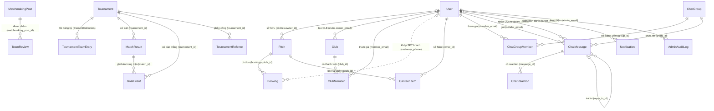

# Mô Hình Dữ Liệu & Nghiệp Vụ

Tài liệu này mô tả **tầng dữ liệu của Turfzone**: các entity JPA, bảng thật trong MySQL, quan hệ giữa chúng, những quy tắc nghiệp vụ đã được cài ngay trong code (không phải quy tắc "mong muốn"), dữ liệu mẫu do hệ thống tự sinh, và các rủi ro dữ liệu còn tồn tại.

Nguyên tắc biên soạn: **mọi dòng trong tài liệu này đều đối chiếu với mã nguồn hiện tại**. Tên bảng lấy từ `@Table(name = ...)`; tên cột lấy từ `@Column(name = ...)` hoặc suy ra từ naming strategy (xem mục 1.3 — các cột suy ra được ghi rõ là "suy ra"). Những chỗ code **không** có gì (ví dụ không có entity VAR, không có `@ManyToOne`) được ghi rõ là không có, thay vì mô tả theo ý muốn thiết kế.

Phạm vi: `backend-core/src/main/java/com/turfzone/{model,repository,service,util,config}` và `backend-core/src/main/resources/{application.yml,db_migration_new.sql}`.

## Mục lục

1. [Tổng quan](#1-tổng-quan)
2. [Sơ đồ quan hệ](#2-sơ-đồ-quan-hệ)
3. [Từ điển entity](#3-từ-điển-entity)
4. [Quy tắc nghiệp vụ đã cài trong code](#4-quy-tắc-nghiệp-vụ-đã-cài-trong-code)
5. [Dữ liệu mẫu & di trú](#5-dữ-liệu-mẫu--di-trú)
6. [Rủi ro & điểm cần cải thiện](#6-rủi-ro--điểm-cần-cải-thiện)

---

## 1. Tổng quan

### 1.1 Nền tảng

| Hạng mục | Giá trị thực tế trong code | Dẫn chứng |
|---|---|---|
| Hệ quản trị CSDL | MySQL 8 | `pom.xml` khai báo `mysql-connector-j`; URL mặc định `jdbc:mysql://localhost:3306/soccerhub_db` |
| Tên CSDL mặc định | `soccerhub_db` | `application.yml` → `${MYSQL_DATABASE:${MYSQLDATABASE:soccerhub_db}}` |
| Framework | Spring Boot 3.2.3 + Spring Data JPA (Hibernate) | `spring-boot-starter-parent` 3.2.3, `spring-boot-starter-data-jpa` |
| Phiên bản Java | `java.version` = **17** trong `pom.xml` | `backend-core/pom.xml` |
| Dialect | `org.hibernate.dialect.MySQLDialect` | `application.yml` → `spring.jpa.properties.hibernate.dialect` |
| Đồng bộ schema | `ddl-auto: ${DDL_AUTO:update}` | `application.yml` |
| Log SQL | `show-sql: ${JPA_SHOW_SQL:false}` | `application.yml` |
| Connection pool | HikariCP, `maximum-pool-size: 5`, `keepalive-time: 180000` | `application.yml` |
| Giữ kết nối | `SELECT 1` mỗi 240 giây | `config/DatabaseKeepAliveScheduler.java` |

> [!WARNING]
> `ddl-auto=update` là chế độ mặc định khi chạy thật. Hibernate sẽ tự `ALTER TABLE` theo entity, **không xoá cột** đã bị bỏ khỏi code, **không đổi kiểu cột** đã có dữ liệu, và có thể tạo bảng mới thiếu FK/index. Trên production nên đặt `DDL_AUTO=validate` (hoặc `none`) và chạy `db_migration_new.sql` có kiểm soát.

### 1.2 Kiểu ID

Toàn bộ 18 entity dùng chung một khuôn:

```java
@Id
@GeneratedValue(strategy = GenerationType.IDENTITY)
private Long id;
```

- Kiểu Java: `Long`; kiểu MySQL: `bigint` `AUTO_INCREMENT`.
- `TournamentTeamEntry` là `@Embeddable` **không có id** — nó tồn tại như một dòng trong bảng con `tournament_registered_teams`.
- Các bảng con `@ElementCollection` cũng không có id; khoá chỉ là cặp (`pitch_id`, `court_name`) hoặc FK đơn.
- Khoá nghiệp vụ thay cho ID: `users.email` (JWT subject), `clubs.slug`, `bookings.code`. Rất nhiều quan hệ trong hệ thống trỏ bằng **email** hoặc **tên đội** chứ không bằng id — đây là đặc điểm quan trọng nhất của mô hình dữ liệu này.

### 1.3 Naming strategy và tên cột suy ra

`application.yml` **không** khai báo `spring.jpa.hibernate.naming.physical-strategy`, nên Hibernate dùng mặc định của Spring Boot: `CamelCaseToUnderscoresNamingStrategy`.

Hệ quả: field `fullName` → cột `full_name`, `cashCollected` → `cash_collected`, `isClubRep` → `is_club_rep`, `registeredAt` → `registered_at`. Điều này được xác nhận gián tiếp bởi `db_migration_new.sql` — file migration viết tay dùng đúng các tên `profile_completed`, `cash_collected`, `total_price`, `deposit_paid`, `pitch_id`, `base_price`, `court_name`.

Trong tài liệu này, cột nào không có `@Column(name=...)` sẽ được ghi kèm chú thích *(suy ra)*.

**Ngoại lệ có khai báo tường minh:** `Notification.read` → `is_read` (bắt buộc, vì `read` là từ khoá SQL); `ClubMember` → `club_id`, `member_email`, `member_name`, `member_phone`; `ChatGroupMember` → `group_id`, `member_email`, `member_name`; `ChatReaction` → `message_id`, `user_email`.

### 1.4 Chiến lược quan hệ: thực tế là **không dùng quan hệ JPA**

Đây là điểm cần nói rõ để tránh hiểu sai: **trong toàn bộ package `com.turfzone.model` không có một `@ManyToOne`, `@OneToMany`, `@OneToOne`, `@ManyToMany` hay `@JoinColumn` nào.** Mọi "quan hệ" đều là cột vô hướng (`Long` id, `String` email) do code tự tra cứu.

Cái duy nhất JPA quản lý quan hệ là **6 `@ElementCollection`**:

| Entity chủ | Field | Bảng con | Cột |
|---|---|---|---|
| `Pitch` | `pitchTypes` | `pitch_types` | `pitch_id`, `pitch_type` |
| `Pitch` | `amenities` | `pitch_amenities` | `pitch_id`, `amenity` |
| `Pitch` | `courtBasePrices` | `pitch_court_base_prices` | `pitch_id`, `court_name` (map key), `base_price` |
| `Pitch` | `courtPeakPrices` | `pitch_court_peak_prices` | `pitch_id`, `court_name` (map key), `peak_price` |
| `Tournament` | `invitedEmails` | `tournament_invited_emails` | `tournament_id`, `email` (varchar 160) |
| `Tournament` | `teams` | `tournament_registered_teams` | `tournament_id` + 10 cột của `TournamentTeamEntry` |

Cả 6 collection đều `fetch = FetchType.EAGER` **kèm** `@BatchSize(size = 100)`. `@BatchSize` là biện pháp chống N+1 có chủ đích, được ghi chú ngay trong `Pitch.java` và `Tournament.java`.

**Hệ quả của việc không dùng JPA relation:**

- Không có cascade, không có orphan removal: xoá `Pitch` **không** xoá `Booking` của sân đó; xoá `Tournament` không xoá `MatchResult`. Việc dọn dẹp nằm ở code (`clearTournamentResults`, `clubMemberRepository.deleteByClubId`, `ChatGroupController#deleteGroup`).
- Không có lazy loading: muốn lấy chủ sân phải `userRepository.findById(pitch.getOwnerId())` (ví dụ `PitchBookingController.sendBookingEmails`).
- Tên đội (`team_a`, `team_b`, `winner`, `reviewed_team_name`…) là **chuỗi tự do**, không có bảng `teams`. Đây là lý do `TeamFormService` phải so khớp `ignore case`.

### 1.5 Ràng buộc duy nhất (unique) đang có

`users.email` (`@Column(nullable=false, unique=true)`), `clubs.slug` (`unique=true, length=120`), `bookings.code` (`@Column(unique=true)`), UNIQUE (`club_id`, `member_email`) trên `club_members`, UNIQUE (`group_id`, `member_email`) trên `chat_group_members`, UNIQUE (`message_id`, `user_email`, `emoji`) trên `chat_reactions`, và PK (`pitch_id`, `court_name`) trên `pitch_court_base_prices` / `pitch_court_peak_prices` (JPA sinh, migration khai báo).

**Không có** unique cho `users.phone`, cho `bookings(pitch_id, court_name, booking_date, time_slot)`, cho `goal_events(tournament_id, match_id, player_name)`, hay `match_results(tournament_id, match_id)`. Chống trùng ca sân là trách nhiệm của tầng ứng dụng (mục 4.1, 4.2).

### 1.6 Bảng thật trong CSDL

**18 bảng entity:**

`users`, `pitches`, `bookings`, `tournaments`, `tournament_referees`, `match_results`, `goal_events`, `matchmaking_posts`, `team_reviews`, `clubs`, `club_members`, `chat_groups`, `chat_group_members`, `chat_messages`, `chat_reactions`, `canteen_items`, `notifications`, `admin_audit_logs`.

**6 bảng con của `@ElementCollection`:**

`pitch_types`, `pitch_amenities`, `pitch_court_base_prices`, `pitch_court_peak_prices`, `tournament_invited_emails`, `tournament_registered_teams`.

Tổng cộng **24 bảng**. Ngoài ra `UserRole` là enum Java lưu dạng `VARCHAR` (`EnumType.STRING`), không phải bảng.

### 1.7 Kiểu dữ liệu thời gian — điểm bất thường có chủ đích

Phần lớn entity dùng `LocalDateTime` (`created_at`, `updated_at`, `played_at`, `joined_at`…), nhưng các trường **nghiệp vụ** quan trọng lại lưu dạng **chuỗi**: `bookings.booking_date` (`varchar`, `YYYY-MM-DD` theo comment), `bookings.time_slot` (`varchar`, `"16:00 - 17:30"`), `tournaments.start_date`/`end_date`/`registration_deadline` (`varchar`, `YYYY-MM-DD`) và `tournaments.bracket_json` (`TEXT`, JSON tự do).

Hệ quả: mọi phép so sánh ngày/giờ là so sánh **chuỗi** (`startsWith(prefix)`, `LocalDate.parse` khi cần); không thể dùng hàm ngày của MySQL nếu dữ liệu không đúng định dạng. Rủi ro được nêu ở mục 6.

---

## 2. Sơ đồ quan hệ

Sơ đồ dưới đây gồm **23 quan hệ thật** tra được trong code. Đường liền = khoá lưu trực tiếp (id/email); đường đứt = quan hệ tra cứu lúc chạy, không có cột khoá.



### 2.1 Cụm "người dùng & hồ sơ"

`User` là gốc của gần như mọi thứ, nhưng **không có entity hồ sơ riêng**: chỉ số cầu thủ (`dominantFoot`, `jerseyNumber`, `height`, `weight`, `preferredTime`, `currentClub`) nằm ngay trong bảng `users` dưới dạng chuỗi. Cờ `profileCompleted` có ba trạng thái (`null` = tài khoản cũ, `false` = mới đăng ký, `true` = đã khởi tạo) — xem `AuthService.register` và `PitchBookingController.createPitch`.

Quan hệ người dùng → sân là **một chiều và có thể null**: `pitches.owner_id` trỏ `users.id`, nhưng 6 trong 9 sân seed có `owner_id = NULL` (sân công cộng). `PitchService.assertCanManage` chặn chủ sân sửa sân không có chủ.

Quan hệ người dùng → đơn đặt sân **không tồn tại ở tầng dữ liệu**: `bookings` chỉ có `customer_name` + `customer_phone`. Hệ thống "nhận ra" đơn của một người bằng cách so `users.phone` với `bookings.customer_phone` (`resolveCustomerEmail`, `cancelBookingByCustomer`, `searchBooking`). Đó là đường đứt trong sơ đồ.

### 2.2 Cụm "sân & ca & đơn"

`Pitch` (cụm sân) chứa **danh sách sân con** ngay trong bảng `pitch_types`; "sân con" không phải entity. Booking tham chiếu sân con bằng **tên** (`bookings.court_name`) chứ không bằng id, nên đổi tên sân con sẽ làm mồ côi các đơn cũ (xem mục 6).

Giá có hai tầng: giá giờ của cụm (`avg_price_per_hour`, `peak_price_per_hour`) và giá ghi đè riêng từng sân con (`pitch_court_base_prices`, `pitch_court_peak_prices`). Không có bảng giá theo ngày/giờ — mọi phép tính giá đều suy ra lúc chạy.

`CanteenItem` treo vào cả `pitch_id` (bán ở cụm nào) và `owner_id` (ai sở hữu) để kiểm tra quyền khi ADMIN thao tác.

### 2.3 Cụm "giải đấu & nhánh & kết quả"

`Tournament` là entity "dày" nhất: nó chứa danh sách đội (`tournament_registered_teams`), danh sách email mời (`tournament_invited_emails`), **và toàn bộ nhánh đấu dưới dạng JSON** (`bracket_json`).

`MatchResult` là **nguồn sự thật duy nhất** về kết quả thi đấu: bảng xếp hạng, chuỗi phong độ, tỷ lệ thắng đều tính lại từ bảng này. `GoalEvent` gắn với trận bằng cặp (`tournament_id`, `match_id`) — không có FK, và `match_id` là chuỗi người đọc được (`R1-M1`, `R2-M1`, `R1-BYE1`).

`TournamentReferee` là bảng độc lập, không liên kết với `User` (chỉ có `email`/`phone` dạng văn bản): trọng tài **không cần tài khoản**.

### 2.4 Cụm "cộng đồng & CLB"

`Club` có `owner_email` (người tạo) **và** `club_members.is_representative` (vai trò thật). Hai nguồn này có thể lệch nhau: `owner_email` là "người tạo", còn quyền quản lý nằm ở `is_representative`. `ClubController.myClubs` hợp nhất cả hai tập để hiển thị.

`ClubMember` và `ChatGroupMember` đều tham chiếu người dùng bằng **email** chứ không bằng `user_id`, nên đổi email tài khoản (chức năng có thật trong `AuthService.updateUserProfile`) sẽ **làm đứt** quan hệ thành viên.

`MatchmakingPost` → `TeamReview` quan hệ một chiều qua `matchmaking_post_id` (nullable, vì đánh giá "tự do" vẫn được ghi nhận ở tầng dữ liệu dù API hiện bắt buộc phải có post id).

### 2.5 Cụm "chat"

Ba loại hội thoại dùng **chung một bảng** `chat_messages`, phân biệt bằng cột:

- `recipient_email != null` → tin nhắn trực tiếp (DM).
- `group_id != null` → tin trong phòng nhóm.
- cả hai `null` → tin công khai trong kênh, phân kênh bằng `channel`.

Ràng buộc "khi có `group_id` thì `recipient_email` phải null" chỉ là **quy ước trong code** (`ChatGroupController#send` không set `recipientEmail`), không có CHECK constraint. `chat_reactions` gắn với tin bằng `message_id`; `chat_messages.reply_to_id` là self-reference không FK.

---

## 3. Từ điển entity

Quy ước cột "Kiểu": `bigint`, `int`, `varchar(n)`, `TEXT`, `bit(1)`, `datetime(6)` là kiểu MySQL do Hibernate sinh. Ghi chú *(suy ra)* = tên cột theo naming strategy.

### User

Bảng: `users` — tài khoản, hồ sơ cầu thủ, cờ khóa và cờ đại diện CLB.

| Trường | Kiểu | Ghi chú |
|---|---|---|
| id | bigint | PK, IDENTITY |
| email | varchar(255) | NOT NULL, UNIQUE; là "tên đăng nhập" và là subject của JWT |
| password | varchar(255) | NOT NULL; BCrypt; `@JsonIgnore` nên không ra JSON |
| fullName | varchar(255) | NOT NULL |
| phone | varchar(255) | Không unique ở DB (chỉ kiểm tra ở `AuthService.register`) |
| role | varchar(255) | NOT NULL, `EnumType.STRING`: `PLAYER`, `OWNER`, `ORGANIZER`, `ADMIN` |
| position | varchar(255) | Chức danh hiển thị ("Cầu Thủ Pro", "Chủ Cụm Sân"…) |
| area / favoriteSport / level | varchar(255) | Khu vực; môn yêu thích (mặc định `football`); trình độ ("Nghiệp dư"…) |
| avatar | varchar(255) | URL ảnh **hoặc** chữ viết tắt 2 ký tự |
| dominantFoot, jerseyNumber, height, weight, preferredTime, currentClub | varchar(255) | Sáu chỉ số hồ sơ VĐV, **đều lưu dạng chuỗi** (kể cả số áo, chiều cao, cân nặng) |
| profileCompleted | bit(1) | Ba trạng thái: `NULL`/`0`/`1` |
| enabled | bit(1) | Mặc định `true`; `false` = admin khóa, chặn đăng nhập |
| isClubRep | bit(1) | Mặc định `false`; true nếu đang là đại diện ≥ 1 CLB *(suy ra: `is_club_rep`)* |
| createdAt | datetime(6) | Gán trong `@Builder.Default` |
| updatedAt | datetime(6) | Tự cập nhật qua `@PreUpdate` |

Quan hệ: 1 → nhiều `Pitch` (qua `owner_id`), `Club` (qua `owner_email`), `ClubMember`/`ChatGroupMember`/`ChatMessage`/`Notification`/`AdminAuditLog` (qua email).

Nghiệp vụ đáng chú ý: `profileCompleted` ra đời để thay cờ `localStorage` ở frontend (comment trong `User.java`); `isClubRep` là **cờ bổ sung**, không phải role mới — `AuthService.register` luôn hạ role đăng ký mới về `PLAYER` và chỉ `/admin/users/{id}/role` mới cấp role thật.

### Pitch

Bảng: `pitches` — cụm sân; mỗi cụm chứa nhiều sân con.

| Trường | Kiểu | Ghi chú |
|---|---|---|
| id | bigint | PK |
| name | varchar(255) | NOT NULL |
| address | varchar(255) | NOT NULL |
| area | varchar(255) | Quận/khu vực |
| phone | varchar(255) | Hotline cụm sân |
| bankCode / bankAccount / accountName | varchar(255) | Mã BIN ngân hàng, số TK nhận tiền (migration 4 chuẩn hoá bỏ khoảng trắng), tên chủ TK — dùng sinh QR VietQR |
| ownerId | bigint | NULL = sân công cộng; không FK |
| ownerName | varchar(255) | Bản chụp tên chủ sân (đồng bộ lại khi OWNER đổi tên) |
| latitude | double | Mặc định 16.0544 (Đà Nẵng) |
| longitude | double | Mặc định 108.2022 |
| avgPricePerHour | int | NOT NULL — giá giờ thường |
| peakPricePerHour | int | Giá giờ vàng; bắt buộc ≥ giá thường (`PitchService.updatePrice`) |
| rating | double | Mặc định 5.0; hiện chỉ được ghi lúc tạo |
| openTime | varchar(255) | Mặc định `"14:00"`, dạng `HH:mm` |
| closeTime | varchar(255) | Mặc định `"22:30"` |
| slotDurationMinutes | int | Mặc định 120 — độ dài ca |
| imageUrl | varchar(255) | Ảnh bìa |
| description | varchar(2000) | Mô tả |
| createdAt / updatedAt | datetime(6) | `updatedAt` cập nhật qua `@PreUpdate` |

Bảng con (xem 1.4): `pitch_types` (**đây chính là danh sách sân con**), `pitch_amenities`, `pitch_court_base_prices`, `pitch_court_peak_prices`.

Nghiệp vụ: giá thực thu không đọc trực tiếp `avgPricePerHour` mà nhân hệ số loại sân con (Sân 11 ×2, Sân 7 ×1, còn lại ×0.75) và nhân độ dài ca — xem 4.1. Giá riêng của sân con (map) **được ưu tiên hơn** hệ số.

### Booking

Bảng: `bookings` — một ca đặt sân.

| Trường | Kiểu | Ghi chú |
|---|---|---|
| id | bigint | PK |
| pitchId | bigint | NOT NULL, không FK |
| courtName | varchar(255) | NOT NULL — tên sân con (chuỗi, trùng `pitch_types.pitch_type`) |
| courtType | varchar(255) | Loại sân hiển thị ("Sân 7") |
| bookingDate | varchar(255) | NOT NULL, `YYYY-MM-DD` |
| timeSlot | varchar(255) | NOT NULL, `"HH:mm - HH:mm"` |
| customerName | varchar(255) | NOT NULL |
| customerPhone | varchar(255) | NOT NULL — cũng là "khoá" nhận diện khách |
| totalPrice | int | Giá ca, server tính |
| depositPaid | int | Tiền cọc (50% hoặc 100%) |
| cashDue | int | Còn lại phải thu tại quầy |
| cashCollected | int | **Tiền mặt đã thu thực tế khi check-in** |
| status | varchar(255) | Mặc định `BOOKED` |
| via | varchar(255) | Mặc định `"Tạo Tại Quầy"`; giá trị dùng thật: `"Đặt qua Website"`, `"Tạo Tại Quầy"`, `"VietQR"`, `"Tạo Tại Quầy (Đã Cọc)"` |
| code | varchar(255) | UNIQUE; dạng `VS-{pitchId}-{6 ký tự}` hoặc `SIM-{pitchId}-{5 số}` |
| cancelReason | varchar(255) | Lý do huỷ |
| cancelledBy | varchar(255) | `OWNER`, `ADMIN`, `CUSTOMER` |
| createdAt / updatedAt | datetime(6) | |

Giá trị `status` xuất hiện **trong code** (không chỉ trong comment):

| Giá trị | Nơi ghi | Ý nghĩa |
|---|---|---|
| `BOOKED` | `bookSlotOnline`, `bookOfflineSlot`, seed | Đã đặt, chưa vào sân |
| `PLAYING` | `checkInBooking` | Đã check-in, đang đá |
| `COMPLETED` | seed + simulate | Đã kết thúc (tính doanh thu) |
| `CANCELLED` | 4 endpoint huỷ + seed | Đã huỷ; **không** chiếm ca, **không** tính doanh thu |
| `RESALE` | chỉ có trong comment của `Booking.status` | Không có nhánh code nào ghi giá trị này |

> [!WARNING]
> `Booking.status` là `String` tự do, không có CHECK constraint và không có enum. Bốn endpoint khác nhau ghi bốn giá trị khác nhau; `RESALE` xuất hiện trong comment nhưng không được sinh ra ở đâu. Bất kỳ giá trị lạ nào cũng được ghi vào DB, và `RevenueUtil` coi mọi status khác `PLAYING`/`COMPLETED` là "chưa thu tiền mặt" — nên một lỗi chính tả status sẽ âm thầm làm mất doanh thu.

### Tournament

Bảng: `tournaments` — giải đấu.

| Trường | Kiểu | Ghi chú |
|---|---|---|
| id | bigint | PK |
| title | varchar(255) | NOT NULL |
| description | TEXT | |
| sportType | varchar(255) | Mặc định `SAN_7`; hợp lệ: `SAN_7`, `SAN_5`, `SAN_11`, `FUTSAL` |
| format | varchar(255) | Mặc định `KNOCKOUT`; hợp lệ: `KNOCKOUT`, `ROUND_ROBIN` |
| pitchName | varchar(255) | Sân thi đấu (chuỗi, không trỏ `pitches`) |
| location | varchar(255) | Địa điểm |
| totalTeams / registeredTeams | int | Sức chứa; bộ đếm đội đã đăng ký (mặc định 0) — **có thể lệch** với `teams.size()` |
| prizePool / entryFee | bigint | Tiền thưởng và lệ phí mỗi đội (VNĐ) |
| startDate / endDate / registrationDeadline | varchar(255) | Chuỗi `YYYY-MM-DD` |
| status | varchar(255) | Mặc định `OPEN`; dùng: `OPEN`, `ONGOING`, `COMPLETED` |
| bannerUrl | varchar(255) | Ảnh bìa giải |
| joinMode | varchar(255) | Mặc định `PUBLIC`; hoặc `INVITE_ONLY` (chỉ email trong danh sách mời được đăng ký) |
| bankCode / bankAccount / accountName | varchar(255) | STK nhận lệ phí, sinh QR VietQR |
| bracketJson | TEXT | Toàn bộ nhánh đấu dạng JSON; `null` = chưa bốc thăm |
| createdAt | datetime(6) | |

Bảng con: `tournament_invited_emails` (email mời), `tournament_registered_teams` (danh sách đội).

Nghiệp vụ: `status` chỉ được đổi qua `PATCH /{id}/status`, và `POST /{id}/register` **chỉ nhận đội khi status = `OPEN`** và `registrationDeadline` chưa qua. Đổi `sportType`/`format` bị chặn khi giải đã có đội hoặc đã có `bracketJson`.

### TournamentTeamEntry

`@Embeddable` — không phải entity; mỗi dòng là một đội trong bảng `tournament_registered_teams`.

| Trường | Kiểu | Ghi chú |
|---|---|---|
| teamName | varchar(255) | Tên đội; dùng làm khoá so khớp với `match_results.team_a/team_b` |
| captainName | varchar(255) | Đội trưởng |
| captainEmail | varchar(120) | Email tài khoản đội trưởng — chống 1 tài khoản đăng ký nhiều đội |
| captainPhone | varchar(255) | SĐT đội trưởng (cũng dùng chống trùng) |
| subCaptainPhone | varchar(255) | SĐT đội phó |
| memberCount | int | 1–30 (clamp trong `registerTeam`) |
| memberNames | varchar(2000) | Danh sách tên cách nhau bằng dấu phẩy |
| registrationStatus | varchar(255) | Mặc định `CONFIRMED`; dùng: `PENDING_PAYMENT`, `CONFIRMED`, `SIMULATED` |
| simulated | bit(1) | Mặc định `false`; true = đội do nút "Giả lập đủ đội" sinh |
| registeredAt | datetime(6) | **Chính là hạt giống bốc thăm** (sắp xếp tăng dần) |

`@Transient` (không có cột, tính lại mỗi lần đọc bởi `TeamFormService`): `form`, `record`, `winRate`, `played`, `won`, `drawn`, `lost` — 7 field.

### TournamentReferee

Bảng: `tournament_referees` — trọng tài được phân công cho giải.

| Trường | Kiểu | Ghi chú |
|---|---|---|
| id | bigint | PK |
| tournamentId | bigint | NOT NULL, không FK |
| name | varchar(80) | NOT NULL, 2–80 ký tự |
| email | varchar(120) | Tuỳ chọn; chống trùng theo giải |
| phone | varchar(20) | Chống trùng theo giải |
| status | varchar(255) | Mặc định `ACTIVE`; comment ghi `ACTIVE`/`INACTIVE` nhưng **không có nhánh code nào đổi giá trị** |
| notes | varchar(200) | Chứng chỉ / kinh nghiệm |
| assignedAt | datetime(6) | |

Trọng tài không cần tài khoản: bảng chỉ lưu liên hệ dạng văn bản, không có `user_id`.

### MatchResult

Bảng: `match_results` — kết quả một trận; nguồn sự thật của mọi thống kê.

| Trường | Kiểu | Ghi chú |
|---|---|---|
| id | bigint | PK |
| tournamentId | bigint | NOT NULL |
| matchId | varchar(255) | NOT NULL; `R1-M1`, `R2-M1`, `R1-BYE1` |
| roundName | varchar(255) | "Tứ kết", "Bán kết", "Chung kết", "Vòng 1"… |
| teamA | varchar(255) | NOT NULL — tên đội, không phải id |
| teamB | varchar(255) | NOT NULL |
| scoreA | int | NOT NULL, ≥ 0 |
| scoreB | int | NOT NULL, ≥ 0 |
| winner | varchar(255) | `null` = hoà (chỉ hợp lệ ở `ROUND_ROBIN`) |
| yellowCardsA / yellowCardsB | int | Mặc định 0 |
| redCardsA / redCardsB | int | Mặc định 0 |
| substitutionsA / substitutionsB | int | Mặc định 0 |
| mvpPlayer | varchar(255) | Cầu thủ xuất sắc nhất trận |
| notes | varchar(500) | |
| playedAt | datetime(6) | Mặc định `now()`; dùng để sắp xếp "mới nhất trước" |

Nghiệp vụ: **không có cột điểm, không có cột Elo** — mọi thứ suy ra từ `scoreA`/`scoreB`. Huỷ kết quả sẽ `delete` bản ghi mới nhất theo (`tournamentId`, `matchId`), không lưu lịch sử sửa đổi.

### GoalEvent

Bảng: `goal_events` — một dòng ghi nhận cầu thủ ghi bàn/kiến tạo trong một trận.

| Trường | Kiểu | Ghi chú |
|---|---|---|
| id | bigint | PK |
| tournamentId | bigint | NOT NULL |
| matchId | varchar(255) | NOT NULL, trỏ `match_results.match_id` (cùng giải) |
| playerName | varchar(255) | NOT NULL — chuỗi tự do, không có bảng cầu thủ |
| teamName | varchar(255) | NOT NULL |
| goals / assists | int | Cả hai mặc định 0 |
| createdAt | datetime(6) | |

Nghiệp vụ: khi nhập tỷ số có kèm `scorers`, **tổng bàn của từng đội phải khớp `scoreA`/`scoreB`**, nếu lệch thì API trả 400 (`TournamentController.saveMatchResult`). Bảng xếp hạng vua phá lưới gộp theo cặp (`playerName`, `teamName`).

### MatchmakingPost

Bảng: `matchmaking_posts` — bài đăng "chợ kèo" tìm đối thủ.

| Trường | Kiểu | Ghi chú |
|---|---|---|
| id | bigint | PK |
| teamName | varchar(255) | NOT NULL — đội đăng kèo |
| captainName | varchar(255) | Nếu thiếu thì lấy `captainPhone` |
| captainPhone | varchar(255) | Bắt buộc ở API; dùng để tìm tài khoản chủ kèo |
| reputationScore | int | Mặc định **98**; được tính lại từ `TeamReview` |
| pitchName | varchar(255) | NOT NULL |
| address | varchar(255) | |
| matchTime | varchar(255) | NOT NULL — chuỗi tự do ("19:30 Tối nay") |
| pitchType | varchar(255) | Mặc định `SAN_7` |
| paymentModel | varchar(255) | Mặc định `SPLIT_EQUAL`; hoặc `LOSER_PAYS`, `HOST_COVER` |
| estimatedFee | bigint | Mặc định 50000 |
| note | TEXT | |
| status | varchar(255) | Mặc định `OPEN`; `MATCHED`, `CANCELLED` |
| opponentTeamName | varchar(255) | Đội nhận kèo |
| opponentCaptainName | varchar(255) | |
| opponentCaptainPhone | varchar(255) | |
| matchedAt | datetime(6) | Thời điểm nhận kèo |
| createdAt | datetime(6) | |

`@Transient`: `form`, `record`, `winRate` — gắn live bởi `CommunityController.attachForm`.

### TeamReview

Bảng: `team_reviews` — đánh giá uy tín / fair-play giữa hai đội.

| Trường | Kiểu | Ghi chú |
|---|---|---|
| id | bigint | PK |
| reviewedTeamName | varchar(80) | NOT NULL — đội bị đánh giá |
| reviewerTeamName | varchar(80) | NOT NULL — đội đánh giá, **lấy từ `fullName` tài khoản** |
| matchmakingPostId | bigint | Nullable ở DB; API hiện **bắt buộc** |
| stars | int | NOT NULL, 1–5 (clamp) |
| onTime | bit(1) | Mặc định `true` |
| fairPlay | bit(1) | Mặc định `true` |
| sportsmanship | bit(1) | Mặc định `true` |
| comment | TEXT | |
| createdAt | datetime(6) | |

Không có unique (`matchmaking_post_id`, `reviewer_team_name`) ở DB — chống trùng là kiểm tra ứng dụng (`existsByMatchmakingPostIdAndReviewerTeamName`).

### Club

Bảng: `clubs` — câu lạc bộ bóng đá.

| Trường | Kiểu | Ghi chú |
|---|---|---|
| id | bigint | PK |
| name | varchar(100) | NOT NULL, 3–100 ký tự |
| slug | varchar(120) | NOT NULL, UNIQUE; sinh từ tên, bỏ dấu, thêm `-2`, `-3` nếu trùng |
| description | varchar(500) | |
| area | varchar(120) | |
| phone | varchar(20) | |
| logoUrl | varchar(500) | |
| ownerEmail | varchar(120) | NOT NULL — người tạo CLB |
| ownerName | varchar(80) | |
| maxMembers | int | Mặc định **0 = không giới hạn**; clamp 0–500 |
| createdAt / updatedAt | datetime(6) | |

### ClubMember

Bảng: `club_members` — thành viên CLB, kèm vai trò đại diện.

| Trường | Kiểu | Ghi chú |
|---|---|---|
| id | bigint | PK |
| clubId | bigint | NOT NULL (`club_id`) |
| memberEmail | varchar(120) | NOT NULL (`member_email`) |
| memberName | varchar(80) | Bản chụp tên lúc thêm |
| memberPhone | varchar(20) | |
| isRepresentative | bit(1) | Mặc định `false`; true = đại diện CLB *(suy ra: `is_representative`)* |
| isActive | bit(1) | Mặc định `true`; comment nói "đã xác nhận tham gia" nhưng **không có code nào set false** |
| joinedAt | datetime(6) | |

Ràng buộc: UNIQUE (`club_id`, `member_email`). Tối đa **3 đại diện / CLB** (kiểm tra trong `setRepresentative`), và không thể thu hồi vai trò của đại diện cuối cùng.

### ChatGroup

Bảng: `chat_groups` — phòng chat nhóm (> 2 người).

| Trường | Kiểu | Ghi chú |
|---|---|---|
| id | bigint | PK |
| name | varchar(80) | NOT NULL, 3–60 ký tự; chặn trùng tên (không phân biệt hoa thường) |
| description | varchar(200) | |
| ownerEmail | varchar(120) | NOT NULL — chủ nhóm, không thể tự gỡ mình |
| ownerName | varchar(80) | |
| createdAt | datetime(6) | |

Giới hạn nghiệp vụ: `MAX_MEMBERS = 30`, `MAX_NAME = 60` (`ChatGroupController`).

### ChatGroupMember

Bảng: `chat_group_members` — thành viên phòng nhóm + mốc đọc.

| Trường | Kiểu | Ghi chú |
|---|---|---|
| id | bigint | PK |
| groupId | bigint | NOT NULL (`group_id`) |
| memberEmail | varchar(120) | NOT NULL (`member_email`) |
| memberName | varchar(80) | |
| isOwner | bit(1) | Mặc định `false` *(suy ra: `is_owner`)* |
| lastReadAt | datetime(6) | Mặc định `now()` — mốc tính badge chưa đọc |
| joinedAt | datetime(6) | |

Ràng buộc: UNIQUE (`group_id`, `member_email`). `lastReadAt` được cập nhật bằng câu `UPDATE` trực tiếp (`ChatGroupMemberRepository.markRead` với `@Modifying`), không qua entity.

### ChatMessage

Bảng: `chat_messages` — tin nhắn công khai / DM / tin nhóm.

| Trường | Kiểu | Ghi chú |
|---|---|---|
| id | bigint | PK |
| senderName | varchar(80) | NOT NULL |
| senderEmail | varchar(120) | NOT NULL |
| senderRole | varchar(20) | Bản chụp role để tô màu tên |
| recipientEmail | varchar(120) | NULL = tin công khai/nhóm; khác null = DM |
| recipientName | varchar(80) | |
| channel | varchar(40) | Mặc định `"general"`; 10 slug hợp lệ (xem 4.8) |
| groupId | bigint | NULL = không phải tin nhóm |
| replyToId | bigint | Self-reference, không FK |
| pinned | bit(1) | Mặc định `false`; tối đa 1 tin ghim / kênh |
| fileUrl | varchar(255) | `/api/v1/chat/files/{uuid}.{ext}` |
| fileType | varchar(255) | `IMAGE` hoặc `DOCUMENT` (code không sinh `AUDIO`/`VIDEO` dù comment có nhắc) |
| fileName | varchar(255) | Tên gốc |
| fileSize | bigint | Bytes |
| readAt | datetime(6) | NULL = chưa đọc; **chỉ dùng cho DM** |
| content | TEXT | NOT NULL, tối đa 500 ký tự (validate ở API) |
| createdAt | datetime(6) | |

> [!WARNING]
> `readAt` trên `ChatMessage` không dùng được cho tin nhóm: code có ghi chú thừa nhận "cần bảng riêng để track read per user per group message – bỏ qua hiện tại" (`ChatController.markRead`). Vì vậy trạng thái "đã đọc" của nhóm chỉ được lưu **một mốc chung** trong `chat_group_members.last_read_at`, không thể biết ai đã đọc từng tin.

### ChatReaction

Bảng: `chat_reactions` — emoji reaction.

| Trường | Kiểu | Ghi chú |
|---|---|---|
| id | bigint | PK |
| messageId | bigint | NOT NULL (`message_id`) |
| userEmail | varchar(120) | NOT NULL (`user_email`) |
| emoji | varchar(8) | NOT NULL — đủ chỗ cho emoji nhiều codepoint |
| createdAt | datetime(6) | |

Ràng buộc: UNIQUE (`message_id`, `user_email`, `emoji`). Comment entity nói "mỗi user chỉ được reaction 1 emoji mỗi tin" nhưng unique constraint cho phép **nhiều emoji khác nhau** trên cùng một tin — API `react` là toggle theo từng emoji.

### CanteenItem

Bảng: `canteen_items` — món bán tại quầy của một cụm sân.

| Trường | Kiểu | Ghi chú |
|---|---|---|
| id | bigint | PK |
| pitchId | bigint | NOT NULL — cụm sân sở hữu món |
| ownerId | bigint | NOT NULL — chủ sân, dùng kiểm tra quyền |
| name | varchar(160) | NOT NULL |
| unit | varchar(30) | "chai", "đôi", "bộ"… |
| price | int | NOT NULL, > 0 |
| stock | int | Mặc định 0 — tồn kho hiện tại |
| soldToday | int | Mặc định 0 — đã bán trong ngày |
| soldDate | datetime(6) | Ngày mà `soldToday` đang áp dụng (để reset) |
| createdAt / updatedAt | datetime(6) | |

Nghiệp vụ: bán hàng trừ `stock`, cộng `soldToday`; khi `soldDate` khác ngày hiện tại thì reset `soldToday = 0` trước khi cộng (xem 4.9). Không có bảng chi tiết đơn bán — chỉ có số tổng hợp.

### Notification

Bảng: `notifications` — thông báo hệ thống.

| Trường | Kiểu | Ghi chú |
|---|---|---|
| id | bigint | PK |
| targetRole | varchar(255) | Mặc định `ALL`; `PLAYER`/`OWNER`/`ORGANIZER`/`ADMIN` |
| targetEmail | varchar(255) | Nullable; khác null = gửi đích danh, **chỉ người đó thấy** |
| title | varchar(255) | NOT NULL |
| message | TEXT | |
| type | varchar(255) | Mặc định `SYSTEM`; `BOOKING`, `TOURNAMENT`, `MATCH`, `MATCHMAKING` |
| link | varchar(255) | Link điều hướng nội bộ |
| read | bit(1) | Cột `is_read`, mặc định `false` |
| createdAt | datetime(6) | |

### AdminAuditLog

Bảng: `admin_audit_logs` — nhật ký thao tác quản trị.

| Trường | Kiểu | Ghi chú |
|---|---|---|
| id | bigint | PK |
| adminEmail | varchar(120) | NOT NULL |
| adminName | varchar(255) | Bản chụp tên admin |
| actionGroup | varchar(40) | NOT NULL — `USER`, `TOURNAMENT`, `PITCH`, `BOOKING`, `CHAT`, `MATCHMAKING`, `NOTIFICATION`, `SYSTEM` |
| action | varchar(60) | NOT NULL — ví dụ `LOCK_USER`, `CHANGE_ROLE`, `BROADCAST` |
| target | varchar(160) | Đối tượng bị tác động; **bị cắt còn 160 ký tự** |
| detail | varchar(400) | Mô tả tiếng Việt; **bị cắt còn 400 ký tự** |
| createdAt | datetime(6) | |

Giá trị `actionGroup`/`action` thực tế được ghi trong code hôm nay: `USER`/`LOCK_USER`, `USER`/`UNLOCK_USER`, `USER`/`CHANGE_ROLE`, `USER`/`DELETE_USER`, `MATCHMAKING`/`DELETE_POST`, `BOOKING`/`ADMIN_CANCEL_BOOKING`, `NOTIFICATION`/`BROADCAST`, `NOTIFICATION`/`DELETE_NOTIFICATION`. **Không có** log cho `TOURNAMENT`, `PITCH`, `CHAT`, `SYSTEM` dù comment entity liệt kê các nhóm này.

### UserRole (enum)

Không phải bảng. Bốn giá trị: `PLAYER`, `OWNER`, `ORGANIZER`, `ADMIN`, lưu dạng `VARCHAR` trong `users.role`.

---

## 4. Quy tắc nghiệp vụ đã cài trong code

### 4.1 Sinh ma trận ca từ giờ mở/đóng và chống trùng ca

**Sinh ca** — `util/TimeSlotUtil.generate(openTime, closeTime, durationMinutes)`: đọc giờ dạng `HH:mm` (thiếu → `"14:00"`/`"22:30"`; thiếu `:` thì thêm `:00`); `duration` ≤ 0 → 120; lặp `while (current + duration <= close)` sinh `"HH:mm - HH:mm"`, tối đa 50 vòng (`guard`), dừng nếu phép cộng không tiến (`next <= current`, tức qua nửa đêm); ngoại lệ hoặc rỗng → fallback cứng `14:00 - 16:00`, `16:00 - 18:00`, `18:00 - 20:00`, `20:00 - 22:00`. Hai hàm phụ: `slotsPerDay`, `peakSlotsPerDay`.

**Giờ vàng** — `TimeSlotUtil.isPeakStart(timeSlot)`: chỉ xét **giờ bắt đầu** của ca, là giờ vàng khi ∈ {17, 18, 19}. Đây là định nghĩa duy nhất dùng chung (`PitchBookingController.isPeakStart` chỉ uỷ quyền).

**Ma trận ca** — `GET /api/v1/pitches/{id}/matrix?date=&duration=` (`getPitchMatrix`):

- `courtList = pitch.getPitchTypes()`; **nếu rỗng, endpoint tự ghi 2 sân mặc định vào DB** (`"Sân 7A Cỏ Nhân Tạo"`, `"Sân 5B Futsal"`) rồi `pitchRepository.save(pitch)`.
- Giá gốc `avgPricePerHour` (fallback 350000) và `peakPricePerHour` (fallback **500000** ở matrix nhưng **450000** ở `PitchService.createPitch`). Hệ số theo **tên** sân con: chứa `"11"` ×2, chứa `"7"` ×1, còn lại ×0.75; `courtBasePrices`/`courtPeakPrices` ghi đè hệ số; nhân tiếp `slotDuration / 60`.
- Ca "đã chiếm" = có booking cùng `courtName` (không phân biệt hoa thường) và `isTimeOverlapping`; booking `CANCELLED` bị loại trước nên ca huỷ trở lại trống. Ca nối dài: `isContinuation = true`, giá `"Đã gộp đơn"`, `cashDue = "0k"`.
- "Ca lọt khe": merge các khoảng bận, tìm khoảng trống ≥ 60 phút giữa giờ mở/đóng, chèn ca 60/90/`slotDuration` phút với cờ `isGapSlot = true`. Người xem không phải chủ sân/ADMIN chỉ thấy `maskName`/`maskPhone`.

**Chống trùng ca — ba lớp:** (1) khoá bi quan `findByIdForUpdate` (`@Lock(PESSIMISTIC_WRITE)`) — phải khoá **trước** khi nạp entity, nếu không JPA trả entity đã cache và không chạy `FOR UPDATE`; (2) `isTimeOverlapping` tách chuỗi theo `-` rồi so `String.compareTo` (`s1 < e2 && s2 < e1`); (3) bắt `DataIntegrityViolationException` khi `save` để trả 400 thay vì 500.

> [!WARNING]
> `isTimeOverlapping` so sánh **chuỗi** `"HH:mm"` bằng `compareTo`, nên chỉ đúng khi giờ luôn có 2 chữ số. Một ca nhập tay dạng `"9:00 - 11:00"` sẽ so sánh sai (`"9:0"` > `"18:"` theo từ điển) và có thể **bán trùng ca**. Ngoài ra không có unique constraint ở DB cho (`pitch_id`, `court_name`, `booking_date`, `time_slot`), nên nếu khoá bi quan bị bỏ qua (ví dụ dữ liệu seed/simulate ghi thẳng) thì DB không chặn được trùng.

### 4.2 Đặt sân online/offline, mã `VS-…`, check-in, huỷ, hoàn cọc

**Đặt online** — `POST /api/v1/pitches/{id}/book` (`bookSlotOnline`, yêu cầu đăng nhập, **không** yêu cầu là chủ sân): (1) bắt buộc `courtName`, `timeSlot`, `customerName`, `customerPhone`; (2) khoá dòng sân `findByIdForUpdate`; (3) `isCourtOfPitch` — sân con phải nằm trong `pitchTypes` của cụm (chặn đặt "Sân 11" trên cụm chỉ có sân 5/7); (4) `isBookableDate` — `bookingDate` parse được và **không trước hôm nay**; (5) `isWithinOpeningHours` — ca nằm trong `[openTime, closeTime]`; (6) server tự tính giá (`computeSlotPrice`: hệ số loại sân × độ dài ca thật) và cọc (`computeDeposit`: chỉ nhận **50%** hoặc **100%**, giá trị khác quy về 50%), `cashDue = total - deposit`; (7) kiểm tra trùng ca như 4.1; (8) sinh mã `"VS-" + pitchId + "-" + 6 ký tự UUID in hoa` (ví dụ `VS-3-A1B2C3`), cột `code` UNIQUE; (9) `via` mặc định `"Đặt qua Website"`.

**Đặt tại quầy** — `POST /{id}/book-offline` (alias `/{id}/offline-book`): cùng validate, thêm `assertOwnsPitch` (chỉ chủ sân cụm đó hoặc ADMIN), `via` mặc định `"Tạo Tại Quầy"`. Sau khi lưu: `Notification` đích danh email chủ sân (type `BOOKING`) + email gửi qua **thread daemon** (`sendBookingEmails`), lỗi email không làm hỏng việc tạo đơn.

**Check-in** — `PUT /api/v1/pitches/bookings/{bookingId}/check-in`: chỉ chủ sân của đơn hoặc ADMIN (`assertOwnsBooking`); đơn `CANCELLED` bị chặn (`"Đơn này đã hủy, không thể check-in."`); ghi `status = PLAYING`, **`cashCollected = cashDue`**, rồi `cashDue = 0`. Đây là điểm sửa lỗi quan trọng — trước đây check-in chỉ gán `cashDue = 0` nên tiền mặt biến mất khỏi doanh thu (comment trong `Booking.java` và `db_migration_new.sql` mục 2).

**Huỷ bởi chủ sân** — `POST /bookings/{bookingId}/cancel` (có `reason`) và `DELETE /bookings/{bookingId}`: bắt buộc `assertOwnsBooking`; `cancelledBy` do **server** quyết định (`ADMIN` nếu người gọi là ADMIN, còn lại `OWNER`), không nhận từ client; **không xoá dòng**, chỉ đổi `status = CANCELLED` để khách còn lịch sử và chủ sân còn đối chiếu cọc; trả `refundDeposit = depositPaid` và thông báo cho khách nếu tra được email từ SĐT.

**Huỷ bởi khách** — `POST /bookings/{bookingId}/cancel-by-customer`: xác thực bằng **SĐT** (`currentUser.phone` bỏ khoảng trắng phải bằng `booking.customerPhone`; không có SĐT trong hồ sơ → 400, sai SĐT → 403); chặn khi `PLAYING`/`COMPLETED`, khi `bookingDate` đã qua, khi đã `CANCELLED`; `cancelledBy = "CUSTOMER"`; thông báo gửi **đích danh** email chủ sân của cụm (không gửi role `OWNER` để tránh lộ SĐT khách cho mọi chủ sân). Trả `refundDeposit = depositPaid` nhưng **không có bút toán hoàn tiền nào được ghi** — hoàn cọc là nghiệp vụ ngoài hệ thống.

**Tra cứu** — `GET /bookings/search?query=` (yêu cầu đăng nhập): tìm theo `code` trước rồi `customerPhoneContaining`, kết quả lọc theo quyền (ADMIN thấy hết, chủ sân thấy đơn trong cụm của mình, cầu thủ thấy đơn trùng SĐT của mình).

### 4.3 Doanh thu và tỷ lệ lấp đầy

**Công thức doanh thu duy nhất** — `util/RevenueUtil.settledRevenue(Booking)`:

```
nếu status == CANCELLED           -> 0
deposit = depositPaid ?? 0
cash    = (status ∈ {PLAYING, COMPLETED})
            ? (cashCollected ?? cashDue ?? 0)     // đơn cũ chưa có cashCollected
            : 0
doanh thu = deposit + cash
```

Đơn `BOOKED` chỉ ghi nhận **tiền cọc**; tiền mặt chỉ vào doanh thu sau check-in. Đơn `CANCELLED` luôn bằng 0, kể cả khi đã cọc (phản ánh việc cọc được hoàn).

**Endpoint dùng công thức này:** `GET /pitches/{id}/stats`, `GET /admin/revenue-report`, `GET /admin/overview`, toàn bộ báo cáo CSV (`OwnerReportController`) và phép cộng trong `simulateBookings`.

**Tỷ lệ lấp đầy theo ngày** — `GET /pitches/{id}/stats?date=`: `slotsPerCourt = generateTimeSlots(...).size()`; `totalSlots = số sân con × slotsPerCourt` (chưa khai sân con thì mặc định 2); `bookedSlots` = số booking trong ngày đã loại `CANCELLED`; `occupancyRate = round(bookedSlots × 100 / totalSlots)`; `totalRevenue` **chỉ trả cho chủ sân/ADMIN**. Kèm `onlineBookings`/`counterBookings` (phân loại theo `via` chứa "Website"/"VietQR"/"Online"/"MoMo") và `hourlyBookings` (gộp theo giờ bắt đầu của ca).

**Tỷ lệ lấp đầy theo tháng** — `/admin/revenue-report`: 6 tháng gần nhất; `capacity = Σ (số sân con × slotsPerDay × số ngày trong tháng)`; `occupancyRate = round(bookings × 100 / capacity)` **không chặn trần 100**; `peakHoursRate = peakBooked × 100 / Σ(peakSlotsPerDay × số ngày)`, chặn trần 100, mẫu số ≤ 0 thì fallback `totalCapacity / 3`. Code trước đây chia tổng công suất cho 3 để ước lượng giờ vàng — comment trong `OwnerAdminController` ghi rõ đã thay bằng `peakSlotsPerDay`.

### 4.4 Phong độ 5 trận suy ra từ `match_results`

**Không có Elo, không có cột điểm, không lưu phong độ.** `TeamFormService` (service duy nhất của tầng này) tính lại mỗi lần đọc: `formOf(teamName)` gọi `findByTeamAIgnoreCaseOrTeamBIgnoreCaseOrderByPlayedAtDesc(team, team)`; `formsOf(collection)` gọi `findByTeamAInIgnoreCaseOrTeamBInIgnoreCaseOrderByPlayedAtDesc` — **một query** cho tất cả đội rồi chia nhóm trong bộ nhớ (comment ghi 14 giải × 16 đội ≈ 224 query trước đây). So khớp đội **không phân biệt hoa thường** và có `trim` vì tên đội được gõ tay ở nhiều màn hình.

**Công thức (`computeForm`):** bỏ qua bản ghi có `scoreA`/`scoreB` null; xác định đội đang xét là A hay B → `mine`/`theirs`; `mine > theirs` → `W`, `mine < theirs` → `L`, bằng → `D`. **Chuỗi form tối đa 5 ký tự, ký tự ĐẦU TIÊN là trận GẦN NHẤT** (danh sách đã sắp giảm dần theo `playedAt`): `"WWDLW"` = thắng, thắng, hoà, thua, thắng (mới nhất → cũ nhất). `played = won + drawn + lost` (đếm **toàn bộ** trận, không chỉ 5 trận gần nhất); `winRate = round(100 × won / played)`, `played = 0` → 0; `record()` trả `"W-D-L"` ví dụ `"3-1-2"`.

**Nơi gắn phong độ:** `@Transient` trên `TournamentTeamEntry` (7 field) và `MatchmakingPost` (3 field). Khi nhập kết quả, `saveMatchResult` trả thêm `formChanges` gồm `before`/`after` của cả hai đội để frontend hiển thị "phong độ thay đổi".

> [!WARNING]
> Phong độ gộp **mọi giải** theo tên đội, không giới hạn theo `tournamentId`. Hai đội khác nhau trùng tên (ví dụ hai đội cùng tên "FC Đại Nắng" ở hai giải) sẽ bị **cộng dồn thành tích của nhau**; đổi tên đội trong `tournament_registered_teams` cũng làm mất toàn bộ lịch sử phong độ vì `match_results.team_a/team_b` vẫn giữ tên cũ.

### 4.5 Bốc thăm / bracket, nhập tỷ số, BXH, vua phá lưới, VAR

**Chọn đội được bốc thăm** — `POST /api/v1/tournaments/{id}/draw`: loại đội `PENDING_PAYMENT` (chỉ `CONFIRMED` và `SIMULATED` vào nhánh), cần ≥ 2 đội; **hạt giống = thứ tự đăng ký** (`teams.sort(comparing(registeredAt, nullsLast(naturalOrder())))`) nên đội đóng phí trước xếp trên; `method = "SEEDED_REGISTRATION"`.

**KNOCKOUT:** `p` = luỹ thừa 2 nhỏ nhất ≥ `n`, `byes = p - n`; `byes` đội đầu tiên được **BYE** ngay vòng 1 (`matchId = "R1-BYE{k}"`, `status = "BYE"`, `winner` = chính đội đó); phần còn lại bắt cặp **đầu – cuối** (`rest[i]` vs `rest[size-1-i]`, `matchId = "R1-M{k}"`, seed A = `byes+i+1`, seed B = `n-i`); các vòng sau sinh node `"Thắng R{k}-M{j}"` với `tbd = true`, `status = "TBD"`. Tên vòng theo số đội: 2 → "Chung kết", 4 → "Bán kết", 8 → "Tứ kết", 16 → "Vòng 1/16", 32 → "Vòng 1/32", còn lại → "Vòng loại". Toàn bộ ghi vào `tournaments.bracket_json` + `Notification` type `TOURNAMENT` cho `ALL`.

**ROUND_ROBIN** (`drawRoundRobin`): vòng tròn một lượt (circle method, giữ cố định đội đầu và xoay phần còn lại); `n` lẻ thì thêm đội `null` làm BYE; số vòng = `n` nếu lẻ, `n-1` nếu chẵn; mỗi vòng đánh số `"R{k}-M{j}"`; `method = "ROUND_ROBIN"`; cho phép hoà.

**Nhập tỷ số** — `POST /{id}/matches`: giải phải đã có `bracketJson`; trận phải tồn tại, `status == "SCHEDULED"` và có 2 đội thật (không `tbd`); `KNOCKOUT` **không nhận tỷ số hoà**, `ROUND_ROBIN` nhận; nếu gửi `scorers` thì mỗi cầu thủ phải thuộc đúng 1 trong 2 đội và tổng bàn theo đội phải **khớp tỷ số** (lệch → 400). Ghi 1 dòng `match_results` + N dòng `goal_events`, cập nhật node (`scoreA`, `scoreB`, `winner`, `status = "DONE"`), đẩy đội thắng vào ô `"Thắng {matchId}"` ở vòng sau kèm `fromMatchId`, `form`, `record`, `winRate`, bỏ `tbd`; nếu trận cha đã đủ 2 đội thì `promoteMatchIfReady` đổi `TBD` → `SCHEDULED`. Huỷ kết quả — `DELETE /{id}/matches/{matchId}`: chỉ cho phép khi **các vòng sau chưa có trận `DONE`** (trừ `ROUND_ROBIN`); xoá `match_results` mới nhất + toàn bộ `goal_events` của trận; trả node về `"Thắng {matchId}"` + `tbd = true`; trận về `SCHEDULED`.

**Bảng xếp hạng (BXH):** hệ thống **không có bảng standings** và không có cột điểm/ hiệu số. Ba thứ được gọi là "BXH" đều tính live:

| Tên hiển thị | Endpoint | Cách tính |
|---|---|---|
| BXH phong độ đội bóng | `GET /api/v1/community/players/leaderboard` | Gom tên đội từ mọi giải → `formOf` từng đội → sort `winRate` desc, `played` desc, tên asc → cắt top 10 |
| BXH phong độ trong báo cáo giải | `GET /api/v1/tournaments/{id}/report` (CSV, `TournamentReportController`) | Cùng công thức, không giới hạn top 10 |
| BXH vua phá lưới | `GET /api/v1/tournaments/{id}/scorers`, `GET /api/v1/tournaments/scorers/top?limit=` | Gộp `goal_events` theo (`playerName`, `teamName`), cộng `goals`/`assists`, sort `goals` desc rồi `assists` desc, đánh `rank` |

**Giả lập kết quả** — `POST /{id}/simulate-results`: random tỷ số 0–4 cho mọi trận `SCHEDULED`/`TBD` đã đủ 2 đội (knockout thì ép không hoà), ghi `match_results` + `goal_events` (chọn cầu thủ ngẫu nhiên từ `memberNames`), cập nhật bracket, và khi tìm ra đội vô địch thì đặt giải `COMPLETED` (theo comment; xem `TournamentController` dòng 1181–1185).

**VAR:** **không tồn tại ở tầng dữ liệu.** Không có entity, không có cột `var*`, không có endpoint `/var` trong toàn bộ backend (từ khoá `VAR` chỉ xuất hiện trong mô tả kênh chat `"ho-dap-luat"`). "Tòa VAR" là công cụ phía frontend (`frontend/src/components/TournamentBracket.tsx`, hàm `pushVarLog`) hoạt động trên các trận thật của bracket và **lưu kết quả qua chính** `POST /{id}/matches`. Nhật ký VAR chỉ nằm trong state của trình duyệt.

> [!WARNING]
> Vì nhật ký VAR không được lưu, mọi "biên bản VAR" (góc camera, quyết định, ai bấm) sẽ **mất khi tải lại trang**. Nếu cần truy vết tranh chấp, phải bổ sung bảng `var_reviews`/cột trong `match_results` — hiện tại chỉ còn `match_results.notes` (tối đa 500 ký tự) để ghi chú thủ công.

### 4.6 Chợ kèo: đăng kèo, nhận kèo, đánh giá đội

**Đăng kèo** — `POST /api/v1/community/matchmaking-posts` (yêu cầu đăng nhập): bắt buộc `teamName`, `captainPhone`, `matchTime`, `pitchName`; `estimatedFee` không parse được → 400 (không còn 500); `status = "OPEN"`; `reputationScore` giữ mặc định 98.

**Danh sách** — `GET /matchmaking-posts` sắp xếp `createdAt` giảm dần, mỗi bài được gắn phong độ live. `GET /urgent-market` lọc `status = "OPEN"` và trả về dạng "kèo khẩn cấp" (kèm `form`, `record`, `winRate`, `fee`).

**Nhận kèo** — `POST /matchmaking-posts/{id}/accept`: chỉ nhận khi `status = "OPEN"` (ngược lại 400 "Kèo này đã có đối thủ nhận!"); chặn tự nhận kèo của đội mình bằng cách so SĐT tài khoản với `post.captainPhone`; ghi `status = "MATCHED"`, `opponentTeamName`, `opponentCaptainName` (thiếu thì lấy SĐT), `opponentCaptainPhone`, `matchedAt = now()`; thông báo cho chủ kèo bằng cách tra `users` theo `captainPhone`.

**Đánh giá fair-play** — `POST /community/reviews`: `reviewerTeamName` **lấy từ `fullName` tài khoản đang đăng nhập**, không nhận từ client (chống tự nâng uy tín bằng cách đổi tên đội); không tự đánh giá đội mình (so tên, không phân biệt hoa thường); `matchmakingPostId` **bắt buộc** và mỗi đội chỉ chấm 1 lần / bài đăng (`existsByMatchmakingPostIdAndReviewerTeamName`); `stars` clamp 1–5; ba cờ `onTime`, `fairPlay`, `sportsmanship` mặc định `true`. Sau khi lưu, tính lại uy tín:

```
avgStars  = AVG(stars)
fairRate  = số cờ true / (số đánh giá × 3)
reputationScore = round(0.6 × avgStars/5 × 100 + 0.4 × fairRate × 100), clamp 0..100
```

`reputationScore` mới được ghi vào **mọi** `matchmaking_posts` có `teamName` trùng (không phân biệt hoa thường). `GET /community/reviews/{teamName}` trả `avgStars` (làm tròn 1 chữ số), `reviewCount` và danh sách đánh giá mới nhất trước.

### 4.7 CLB: thành viên, đội trưởng/đại diện

**Tạo CLB** (`POST /api/v1/clubs`): người tạo thành `clubs.owner_email`, đồng thời được chèn 1 dòng `club_members` với `is_representative = true`, sau đó `refreshClubRepFlag` bật `users.is_club_rep`. **Slug**: `slugify` bỏ dấu tiếng Việt (NFC → NFD, xoá `\p{M}`), thay ký tự không phải chữ/số bằng `-`, chữ thường; trùng thì thêm `-2`, `-3`… (`uniqueSlug`).

**Phân quyền**: kiểm tra bằng `isRepresentative(clubId, email)` — đọc từ `club_members`, **không** dựa vào `clubs.owner_email`. Tối đa **3 đại diện** / CLB; không thu hồi được vai trò của đại diện **cuối cùng**; không tự thu hồi vai trò của mình. Thành viên thêm bằng email (email chưa có tài khoản vẫn thêm được, tên/SĐT nhập tay); `maxMembers = 0` nghĩa là không giới hạn, vượt giới hạn → 400; đại diện không tự gỡ mình; sau mỗi lần gỡ, `refreshClubRepFlag` tính lại `users.is_club_rep` cho người bị gỡ. Xoá CLB: chỉ đại diện, xoá toàn bộ `club_members` rồi xoá `clubs`, sau đó refresh cờ cho mọi email liên quan. `memberList` (email + SĐT) chỉ trả cho thành viên/đại diện, người ngoài nhận mảng rỗng.

**"Đội trưởng"** trong CLB: mô hình **không có** trường riêng — vai trò cao nhất là `is_representative`. Khái niệm "đội trưởng" chỉ tồn tại ở `tournament_registered_teams.captain_name/captain_email` và `matchmaking_posts.captain_name`.

### 4.8 Chat: kênh, reaction, ghim, đã đọc, upload file

**Kênh công khai** — danh sách cứng trong `ChatController.VALID_CHANNELS` (10 slug):
`general`, `vang-lai`, `bu-thieu-nguoi`, `doi-30p`, `tinh-trang-san`, `khieu-nai`, `ho-dap-luat`, `do-dung-cu`, `tuyen-cau-thu`, `giai-dau`.

`normalizeChannel` biến mọi slug lạ thành `general`. Tin công khai phải có `recipient_email IS NULL` **và** `group_id IS NULL`; kênh `general` chấp nhận cả `channel IS NULL`.

**Gửi tin** — `POST /api/v1/chat/messages`: nội dung 1–500 ký tự; `senderName`/`senderRole` chụp từ tài khoản; `recipientEmail != null` → DM (và `channel` bị ép về `general`); có `replyToId` thì lưu để trả lời.

**Ghim** — `POST /messages/{id}/pin?value=` : chỉ **tác giả** tin nhắn được ghim; khi ghim thì **bỏ ghim mọi tin khác cùng kênh** → bất biến "1 tin ghim / kênh" được giữ ở tầng ứng dụng, không có unique constraint.

**Reaction** — `POST /messages/{id}/react?emoji=` là **toggle**: có rồi thì xoá, chưa có thì thêm; unique (`message_id`,`user_email`,`emoji`) chặn trùng. `GET /messages/{id}/reactions` gộp theo emoji, trả `count`, `users` (đã che, chỉ 2 ký tự đầu + `****`), `meReacted`.

**Đã đọc** — hai cơ chế khác nhau:

| Loại | Cơ chế | Endpoint |
|---|---|---|
| DM | `chat_messages.read_at` (chỉ người nhận được set) | `POST /messages/{id}/read` |
| Nhóm | `chat_group_members.last_read_at` (mốc chung) | `POST /chat-groups/{id}/read` và tự động khi gửi tin |

`GET /unread-count` trả `dm` (đếm `recipientEmail = me` và `readAt IS NULL`), `group` (cộng `countUnreadInGroup` cho từng nhóm), `total`.

**Upload** — `POST /api/v1/chat/upload`: chỉ nhận `image/*` và `application/pdf`, `application/msword`, `.docx`; tối đa **10 MB**; lưu vào `uploads/chat/yyyy/MM/dd/{uuid}{ext}`; trả `fileUrl = /api/v1/chat/files/{uuid.ext}`, `fileType = IMAGE|DOCUMENT`, `fileName`, `fileSize`. `GET /chat/files/{filename}` phục vụ file bằng cách `Files.walk("uploads/chat")` tìm theo tên.

**Nhóm chat** — `POST /api/v1/chat-groups` (tên 3–60, không trùng), người tạo tự thành thành viên `is_owner = true`; tối đa 30 thành viên; chỉ chủ nhóm thêm/gỡ thành viên; chủ nhóm không tự gỡ mình; xoá nhóm sẽ xoá thành viên + 50 tin gần nhất của nhóm (không xoá toàn bộ tin nhóm cũ hơn).

> [!WARNING]
> `ChatGroupController.deleteGroup` chỉ xoá các tin lấy được từ `findTopMessagesByGroupId` (tối đa 50 tin). Tin nhắn cũ hơn **vẫn nằm lại** trong `chat_messages` với `group_id` trỏ tới nhóm đã bị xoá — dữ liệu mồ côi, không truy cập được qua UI nhưng vẫn tồn tại.

### 4.9 Căn tin: bán hàng và tồn kho

`GET /api/v1/canteen/items?pitchId=`: ADMIN thấy tất cả hoặc theo cụm; chủ sân chỉ thấy cụm của mình (kiểm tra `pitch.ownerId`). `POST /items`: bắt buộc `pitchId`, `name`, `price > 0`; `ownerId` lấy từ `pitch.ownerId` (sân chưa có chủ thì lấy `me.id`); `stock` mặc định 0, `soldToday = 0`, `soldDate = now()`. `PUT /items/{id}` chỉ cập nhật field có mặt và hợp lệ (`price > 0`, `stock >= 0`). `DELETE /items/{id}`. Quyền: `canManage` = ADMIN hoặc `item.ownerId == me.id`.

**Bán hàng** — `POST /items/{id}/sell` với `qty` (mặc định 1): **chặn nếu `stock < qty`** (400 kèm số tồn còn lại); nếu `soldDate` khác ngày hiện tại thì reset `soldToday = 0` rồi mới cộng; cuối cùng `stock -= qty`, `soldToday += qty`. Không có bảng chi tiết bán hàng và không có liên kết giữa món bán ra với `booking` — doanh thu căn tin **không** được cộng vào doanh thu sân.

### 4.10 Thông báo nội bộ và broadcast

`NotificationService.notify(...)` gói toàn bộ phần ghi trong `try/catch` — **thông báo lỗi không được làm gãy nghiệp vụ chính** (comment ghi rõ). `mine(User)` đọc **50 thông báo mới nhất** (`findTop50ByOrderByIdDesc`) rồi lọc trong bộ nhớ: `targetEmail` khác rỗng → **chỉ** người có email đó thấy (kể cả khi `targetRole` khác); ngược lại thấy khi `targetRole == "ALL"` hoặc bằng role của mình; cắt còn 25 kết quả. `PATCH /{id}/read` chỉ cho người nhận hợp lệ hoặc ADMIN. `POST /notifications/broadcast` (ADMIN): `title`/`message` bắt buộc; `targetRole` thuộc {ALL, PLAYER, OWNER, ORGANIZER, ADMIN}, sai thì quy về `ALL`; `type` luôn `SYSTEM`; ghi audit `NOTIFICATION`/`BROADCAST`. `DELETE /notifications/{id}` (ADMIN): xoá cứng + ghi audit.

> [!WARNING]
> `mine()` chỉ đọc 50 bản ghi mới nhất của **toàn hệ thống**, sau đó mới lọc theo người dùng. Với một tài khoản đang "hot" (broadcast liên tục), 50 bản ghi đó có thể toàn là thông báo của người khác → người dùng **không thấy thông báo đích danh của mình** dù nó vẫn nằm trong DB. Cách lọc này cũng khiến mọi thông báo cũ hơn top-50 vĩnh viễn không hiển thị.

### 4.11 Audit log admin

`AdminAuditService.log(...)` **không bao giờ ném exception**: bắt mọi lỗi, ghi `log.warn` rồi bỏ qua — nhờ vậy bảng log lỗi/chưa tồn tại cũng không chặn thao tác admin. Trước khi ghi, dữ liệu bị cắt: `target` ≤ 160 ký tự, `detail` ≤ 400 ký tự; `adminEmail` null → `"khong-ro-email"`. `recent(group, limit)`: `limit` clamp 1–300; `group` rỗng → tất cả, có group thì `toUpperCase()` rồi lọc; đọc lỗi → danh sách rỗng. `GET /api/v1/admin/audit-logs?group=&limit=` trả mới nhất trước.

Các thao tác **có** ghi log: khoá/mở khoá tài khoản, đổi role, xoá người dùng, xoá bài đăng chợ kèo, admin huỷ đơn đặt sân, broadcast, xoá thông báo. Các thao tác **chưa** ghi log dù entity `AdminAuditLog` có nhóm tương ứng: xoá giải đấu, sửa cụm sân, gỡ tin nhắn chat (`ChatController.adminDeleteMessage`), xoá `TeamReview`.

---

## 5. Dữ liệu mẫu & di trú

### 5.1 Tài khoản demo do `DataInitializer` tạo

`config/DataInitializer.java` là `CommandLineRunner` — **chạy mỗi lần khởi động ứng dụng**. Email viết đúng như trong code (có chữ hoa `Turfzone.vn`).

| Email | Mật khẩu | Role | Điều kiện tạo |
|---|---|---|---|
| `admin@Turfzone.vn` | `admin123` | `ADMIN` | Chỉ tạo khi `countByRole(ADMIN) == 0` **và** email chưa tồn tại |
| `player@Turfzone.vn` | `player123` | `PLAYER` | Khi email chưa tồn tại |
| `owner@Turfzone.vn` | `owner123` | `OWNER` | Khi email chưa tồn tại |
| `organizer@Turfzone.vn` | `organizer123` | `ORGANIZER` | Khi email chưa tồn tại |

Điểm đáng chú ý: admin dùng điều kiện "chưa có admin nào" thay vì "email chưa tồn tại", để nếu quản trị xoá tài khoản `admin@…` thì lần khởi động sau **không tự hồi sinh** tài khoản với mật khẩu `admin123` (comment ghi rõ ý định chống backdoor).

`player@…` có `phone = 0912345678`, `owner@…` có `0987654321`, `organizer@…` có `0909876543` — các SĐT này được dùng để tra cứu chéo (đơn đặt sân, chợ kèo).

### 5.2 Dữ liệu sân, giải, kèo

| Nhóm | Số lượng | Chi tiết |
|---|---|---|
| Cụm sân | 9 | Chỉ seed khi `pitchRepository.count() == 0`. Tất cả ở Đà Nẵng, `slotDurationMinutes` mặc định 120, `ownerId = NULL` |
| Gán sân cho chủ demo | tối đa 3 | `assignDemoPitchesToOwner` gán 3 sân **đang chưa có chủ** cho `owner@Turfzone.vn`; idempotent theo số sân trống |
| Giải đấu | 5 | Chỉ seed khi `tournamentRepository.count() == 0`: Championship Cup (SAN_7, KNOCKOUT, 16 đội, `OPEN`), Mini Sân 5 Sinh Viên (SAN_5, KNOCKOUT, 8 đội, `ONGOING`), Super League Sân 11 (SAN_11, ROUND_ROBIN, 6 đội, `OPEN`), Futsal Doanh Nghiệp (FUTSAL, ROUND_ROBIN, 8 đội, `OPEN`), Giải Phủi Hải Châu Mùa 2 (SAN_7, KNOCKOUT, `COMPLETED`) |
| Giải đã có kết quả | 1 | "Turfzone Grandmaster Series 2026": `COMPLETED`, 4 đội, `bracketJson` có sẵn 2 vòng (Bán kết + Chung kết), **3 dòng `match_results`** để phong độ hiển thị ngay. Điều kiện seed: chưa có giải nào chứa chữ "Grandmaster" **kèm** `bracketJson` |
| Bài chợ kèo | 6 | Chỉ seed khi `matchmakingPostRepository.count() == 0`; đủ 3 `paymentModel` (`SPLIT_EQUAL`, `LOSER_PAYS`, `HOST_COVER`) |
| Đơn đặt sân mẫu | ~9 sân × 22 ngày × 3–6 đơn | Chỉ seed khi `bookingRepository.count() == 0`; dải −14 → +7 ngày; `Random(20261022L)` nên **tái lập được**; mã `SIM-{pitchId}-{5 số}` |

Chi tiết giá trong seed (dùng để đối chiếu khi kiểm thử): Đại Nắng 280k/360k (14:00–23:00), Hải Châu Arena 240k/300k (06:00–22:30), Cụm Sân Đà Nẵng 320k/420k (15:00–23:30), Hải Châu Center 200k/260k, Cẩm Lệ Futsal 180k/230k, Sân 11 Hải Châu 450k/600k, Futsal Ngũ Hành Sơn 300k/400k, Trung Tâm Hải Châu 220k/280k, Beachside Futsal 260k/340k. Bộ môn (`pitchTypes`) của các sân seed dùng **mã** (`SAN_5`, `SAN_7`, `SAN_11`, `FUTSAL`) chứ không phải tên sân con — khác với dữ liệu do chủ sân tạo qua UI.

Phân bố trạng thái đơn seed: ngày quá khứ ~80% `COMPLETED`/12% `BOOKED`/8% `CANCELLED`; hôm nay 30% `COMPLETED`/25% `PLAYING`/39% `BOOKED`/6% `CANCELLED`; tương lai 80% `BOOKED`/20% `CANCELLED`.

### 5.3 Cờ `SIM-`

Hai nơi sinh mã bắt đầu bằng `SIM-`:

1. `DataInitializer.seedDemoBookings`: `"SIM-" + pitchId + "-" + %05d` (bộ đếm tăng dần).
2. `PitchBookingController.simulateBookings` (nút "Giả lập doanh thu"): `SIM_PREFIX + pitchId + "-" + %05d`, dùng `AtomicInteger` khởi tạo ngẫu nhiên 1000–99998 để tránh đụng `code` UNIQUE.

`DELETE /api/v1/pitches/simulate-bookings` xoá các đơn có `code` bắt đầu `SIM-`, **giới hạn trong cụm sân của chủ sân đang đăng nhập** (ADMIN xoá được tất cả). Đơn thật của khách không bị ảnh hưởng. Đây là quy ước quan trọng để tách dữ liệu demo khỏi dữ liệu thật trong cùng một bảng.

### 5.4 Nội dung `db_migration_new.sql`

File nằm trong `backend-core/src/main/resources/`, tự nhận là "migration schema cho production (chạy 1 lần, idempotent)". Từng thay đổi:

| Mục | Thay đổi | Cách làm |
|---|---|---|
| 1 | Thêm `users.profile_completed bit(1) DEFAULT NULL` | Kiểm tra `information_schema.COLUMNS` rồi `PREPARE`/`EXECUTE` câu `ALTER TABLE` — chỉ chạy khi cột chưa có |
| 1b | Đặt `profile_completed = NULL` cho `ADMIN`/`ORGANIZER`/`OWNER` đang NULL | Coi tài khoản cũ là "đã hoàn tất" |
| 2 | Thêm `bookings.cash_collected int DEFAULT NULL` | Cùng kỹ thuật idempotent |
| 2b | Khôi phục tiền mặt cho đơn đã check-in trước khi có cột | `UPDATE ... SET cash_collected = total_price - COALESCE(deposit_paid,0) WHERE cash_collected IS NULL AND cash_due = 0 AND status IN ('PLAYING','COMPLETED') AND total_price > COALESCE(deposit_paid,0)` |
| 3 | Tạo `pitch_court_base_prices`, `pitch_court_peak_prices` | `CREATE TABLE IF NOT EXISTS`, PK (`pitch_id`,`court_name`), FK tới `pitches(id)`, utf8mb4 |
| 4 | Bỏ khoảng trắng trong `pitches.bank_account` | `UPDATE ... REPLACE(bank_account,' ','')` vì VietQR nhét nguyên chuỗi vào URL |
| 5 | Ghi chú chuẩn hoá địa danh Đà Nẵng | Chỉ là comment, trỏ sang file `fix_db_danang3.sql` không có trong repo |

File này **không** tạo 18 bảng entity (giả định `ddl-auto` đã tạo), chỉ vá các thay đổi schema phát sinh sau khi hệ thống đã chạy.

### 5.5 Cảnh báo về `ddl-auto=update` trên production

- `ddl-auto` mặc định `update`; biến `DDL_AUTO` cho phép đổi (`none`/`validate`) nhưng comment trong `application.yml` nói rõ đây là đường "thoát hiểm" tạm thời khi MySQL chưa sẵn sàng, không phải cấu hình production.
- `update` **không** xoá cột/bảng đã bỏ, **không** thu nhỏ `varchar`, **không** thêm unique cho bảng đã có dữ liệu trùng (sẽ lỗi hoặc bị bỏ qua tuỳ phiên bản), và **không** đảm bảo thứ tự áp dụng khi có nhiều instance khởi động cùng lúc.
- Với 24 bảng và 6 bảng `@ElementCollection` (schema do Hibernate sinh hoàn toàn), việc đổi tên field sẽ tạo **cột mới rỗng** bên cạnh cột cũ còn dữ liệu — không có migration nào chuyển dữ liệu.
- Toàn bộ "di trú" thật của dự án nằm ở 5 mục trong `db_migration_new.sql`, tức là rất mỏng so với số thay đổi schema mà lịch sử code thể hiện (nhiều cột mới như `cash_collected`, `profile_completed`, `is_club_rep`, `join_mode`, `bracket_json`… chỉ được thêm bằng `update`).

---

## 6. Rủi ro & điểm cần cải thiện

Chỉ liệt kê những điểm **thấy được trong code**, kèm dẫn chứng.

### 6.1 Thiếu index trên các cột truy vấn thường xuyên

| Truy vấn | File | Vấn đề |
|---|---|---|
| `findByPitchIdAndBookingDate(id, date)` | `BookingRepository` | Được gọi ở **mọi** lần mở ma trận ca, mọi lần đặt sân, mọi lần thống kê. Không có index trên (`pitch_id`, `booking_date`) → full table scan |
| `findByCustomerPhoneContaining` | `BookingRepository` | `LIKE '%...%'` không dùng được index; gọi ở tra cứu vé và ở `AdminManageController` |
| `findByTeamAIgnoreCaseOrTeamBIgnoreCaseOrderByPlayedAtDesc` | `MatchResultRepository` | `LOWER()`/`UPPER()` trên cột so sánh → không dùng index; gọi cho từng đội ở `getUrgentMarket`, `getFormLeaderboard` |
| `findTopMessagesByGroupId`, `countUnreadInGroup` | `ChatMessageRepository` | `ORDER BY created_at DESC LIMIT 50` trên `chat_messages` không index (`group_id`, `created_at`) |
| `findByTournamentIdOrderByPlayedAtAsc` | `MatchResultRepository` | Không index `tournament_id` |

### 6.2 Thiếu khoá ngoại (FK)

Khoá ngoại **chỉ tồn tại trên 6 bảng con của `@ElementCollection`** (Hibernate sinh khi `ddl-auto` tạo bảng, hoặc `db_migration_new.sql` khai báo tường minh cho 2 bảng giá sân con). Những quan hệ còn lại **không có FK ở DB**: `bookings.pitch_id` (có thể trỏ tới sân đã bị xoá — `PitchService.deletePitch` chỉ `delete(pitch)`, không kiểm tra booking), `match_results.tournament_id`, `goal_events.tournament_id`, `tournament_referees.tournament_id`, `canteen_items.pitch_id`/`owner_id`, `club_members.club_id`, `chat_group_members.group_id`. Riêng **mọi quan hệ bằng email** (`owner_email`, `member_email`, `sender_email`, `admin_email`, `target_email`) không có cơ chế đồng bộ: `AuthService.updateUserProfile` cho phép đổi email nhưng **không** cập nhật `club_members`, `chat_group_members`, `chat_messages`, `clubs.owner_email` → mồ côi dữ liệu.

### 6.3 Trùng ca sân không được chặn ở tầng DB

Không có unique cho (`pitch_id`, `court_name`, `booking_date`, `time_slot`). `isTimeOverlapping` so sánh chuỗi nên nhạy với định dạng (mục 4.1). `simulateBookings` và `DataInitializer` ghi đơn **không đi qua** khoá bi quan, chỉ tự kiểm tra trong danh sách của ngày — đủ cho demo nhưng không phải ràng buộc dữ liệu. Thêm vào đó, `GET /api/v1/pitches/{id}/matrix` có thể `save(pitch)` khi `pitchTypes` rỗng (tự thêm 2 sân mặc định): một request **đọc** — kể cả bị crawler gọi — tạo ra thay đổi dữ liệu và có thể ghi đè ý định của chủ sân đang cấu hình sân.

### 6.4 Ngày/giờ lưu dạng chuỗi

`bookings.booking_date`, `bookings.time_slot`, `tournaments.start_date/end_date/registration_deadline` là `varchar`, nên không lọc/sắp xếp theo khoảng thời gian ở SQL (`buildRevenueCsv` phải `startsWith(prefix)` theo `"YYYY-MM"`); `TournamentController.updateTournament` nhận ngày dạng chuỗi **không validate định dạng** (chỉ `registerTeam` mới `LocalDate.parse` và bỏ qua lỗi); so sánh "hôm nay" phụ thuộc `LocalDate.now()` của server, không có múi giờ lưu kèm.

### 6.5 Cột JSON/TEXT dài và dữ liệu bán cấu trúc

`tournaments.bracket_json` (TEXT) chứa **toàn bộ** cây nhánh đấu: mỗi lần nhập tỷ số phải `readValue` cả cây, sửa một node, `writeValueAsString` rồi `save` cả entity — với giải 32 đội, mỗi lần lưu là ghi lại vài chục KB. `saveMatchResult` duyệt **tất cả** vòng × trận × 2 phía để tìm ô `"Thắng {matchId}"` (O(vòng × trận) cho mỗi bàn thắng), `simulateResults` lặp lồng tương tự (O(n²) trên số trận). Các cột dài khác: `match_results.notes` (500), `team_reviews.comment`, `matchmaking_posts.note`, `chat_messages.content` (đều TEXT). `bracket_json` **không có version/schema**: đổi cấu trúc JSON sẽ làm hỏng mọi giải đã bốc thăm (`readValue` trả `Map` không kiểm kiểu, lỗi chỉ hiện khi đọc field).

### 6.6 Dữ liệu demo lẫn dữ liệu production

`DataInitializer` là `CommandLineRunner` **luôn chạy**, không có `@Profile`. Trên môi trường thật, lần khởi động đầu tiên sẽ tạo 4 tài khoản demo với mật khẩu cố định trong code (`admin123`, `player123`, `owner123`, `organizer123`); 9 cụm sân, 5 giải, 6 bài chợ kèo, 1 giải "Grandmaster" kèm 3 trận và khoảng **600–1000 đơn đặt sân** giả (mã `SIM-`) nếu `bookings` đang rỗng. Các đơn `SIM-` này **có mặt trong doanh thu** (`RevenueUtil` không phân biệt) nên báo cáo tháng của chủ sân bị thổi phồng cho tới khi ai đó bấm "Xoá đơn giả lập"; `assignDemoPitchesToOwner` còn gán 3 sân công cộng cho `owner@Turfzone.vn`, tức tài khoản demo có quyền sửa dữ liệu thật.

> [!WARNING]
> Không có cột `is_demo`/`source` trên `bookings` hay `users`. Cách duy nhất để phân biệt dữ liệu demo hiện nay là **tiền tố `code = 'SIM-'`** và 4 email cố định — cả hai đều có thể bị người dùng thật tạo ra. Nếu deploy nguyên trạng, mật khẩu `admin123` là lỗ hổng chiếm quyền ADMIN.

### 6.7 N+1 và đọc toàn bảng trong bộ nhớ

Đã có nhiều chỗ chống N+1 bằng `@BatchSize` và `formsOf` (đáng ghi nhận), nhưng vẫn còn:

| Vị trí | Dẫn chứng | Hệ quả |
|---|---|---|
| `CommunityController.getMatchmakingPosts` | `posts.forEach(this::attachForm)` — 1 query phong độ / bài | N bài = N+1 query (khác với `TournamentController` đã gộp bằng `formsOf`) |
| `CommunityController.getUrgentMarket` | `teamFormService.formOf(p.getTeamName())` trong vòng lặp | N+1 |
| `CommunityController.getFormLeaderboard` | `formOf` cho từng tên đội | N+1 (đã có `formsOf` sẵn nhưng chưa dùng) |
| `CommunityController.updateReputationScore` | `matchmakingPostRepository.findAll()` rồi lưu từng bài | Đọc toàn bảng + N lần `save` |
| `OwnerReportController.buildRevenueCsv` / `buildBookingsCsv` / `buildSummaryCsv` | `bookingRepository.findAll()` **bên trong** vòng lặp tháng/cụm sân | O(số tháng × toàn bộ đơn); 6 tháng = 6 lần đọc cả bảng |
| `AdminController.getOverview` | `bookingRepository.findAll().stream()` + `userRepository.findAll()` cho **mỗi** role (4 lần) | Đọc toàn bảng nhiều lần cho 1 request dashboard |
| `OwnerAdminController.getRevenueReport` | `bookingRepository.findAll().stream()` | Lọc trong bộ nhớ thay vì `WHERE pitch_id IN (...)` |
| `ChatGroupController.displayNameOf` / `addMember` | `userRepository.findAll().stream()` cho **mỗi** thành viên | Thêm 29 thành viên = 29 lần đọc toàn bảng `users` |
| `ChatGroupController.create` | `groupRepository.findAll()` để so tên nhóm | Đọc toàn bảng cho mỗi lần tạo nhóm |

### 6.8 Ràng buộc "một dòng" không được đảm bảo

`BookingRepository.findByCustomerPhone(String): Optional<Booking>` — một SĐT có thể có nhiều đơn, nên nếu method này được dùng Spring Data sẽ ném `IncorrectResultSizeDataAccessException`; hiện **chưa nơi nào gọi** nhưng method vẫn nằm trong repository và rất dễ bị dùng nhầm (các chỗ khác đều dùng `findByCustomerPhoneContaining` trả `List`). `ChatMessageRepository.findPinnedByChannel` trả `List` với `LIMIT 50` trong khi nghiệp vụ chỉ cho 1 tin ghim, nên code lấy `get(0)` và dựa vào việc bỏ ghim trước đó. `Tournament.registeredTeams` là bộ đếm **có thể lệch** với `teams.size()` — comment trong `registerTeam` thừa nhận ("trường registeredTeams có thể lệch với list do seed"); các endpoint mới đã chuyển sang đếm `teams`, nhưng dữ liệu cũ vẫn có thể sai.

### 6.9 Vấn đề bảo mật dữ liệu ở tầng entity

`@Data` (Lombok) sinh `toString()`/`equals()`/`hashCode()` trên **entity**: `toString()` của `User` **bao gồm `password`** (hash BCrypt) nên bất kỳ `log.info("{}", user)` nào cũng ghi hash vào log — `@JsonIgnore` chỉ chặn Jackson, không chặn `toString`. `equals`/`hashCode` dựa trên id sinh tự tăng nên không an toàn khi đặt entity vào `Set`/`Map` trước và sau `save`. Nhiều endpoint trả **entity thô** (`Pitch`, `Booking` ở `/book`, `/book-offline`, `ChatMessage`), nên thêm field mới vào entity sẽ tự động lộ ra API công khai; một số endpoint đã có bản che (`maskedBooking`, `sanitizeTournament`) nhưng không đồng bộ toàn hệ thống.

### 6.10 Dữ liệu bị bỏ rơi / không có cơ chế dọn

`admin_audit_logs` **không bao giờ bị xoá** và không có index `created_at` → bảng chỉ tăng. `notifications` không có cơ chế hết hạn, `mine()` chỉ đọc 50 bản mới nhất nên thông báo cũ thành rác vĩnh viễn. Tin nhắn nhóm cũ hơn 50 tin còn lại sau khi xoá nhóm (mục 4.8). `chat_messages.read_at` bị bỏ trống cho tin nhóm; `chat_group_members.is_active` và `tournament_referees.status` là cột chết (không nhánh code nào đổi giá trị). `Pitch.rating` chỉ được ghi lúc tạo (`PitchService.createPitch` set 5.0 hoặc seed) — không có luồng đánh giá sân nào cập nhật, nên `rating` hiện là dữ liệu trang trí.

### 6.11 Điểm chưa xác minh được trong phạm vi tài liệu này

Trạng thái schema **thực tế** của CSDL đang chạy (index/FK do Hibernate sinh có thể khác nhau giữa các môi trường) — cần `SHOW CREATE TABLE` trên DB thật để đối chiếu. Sự tồn tại của `fix_db_danang3.sql` (được `db_migration_new.sql` nhắc tới nhưng không có trong repo). Hành vi của MySQL khi `@ElementCollection` `List` không có `@OrderColumn` (Hibernate dùng bag, không đảm bảo thứ tự `teams`/`invitedEmails` sau khi đọc lại) — chưa có test nào khẳng định thứ tự. Nội dung `docs/API.md`, `docs/FRONTEND.md` không nằm trong phạm vi nhiệm vụ này nên chưa đối chiếu chéo.
