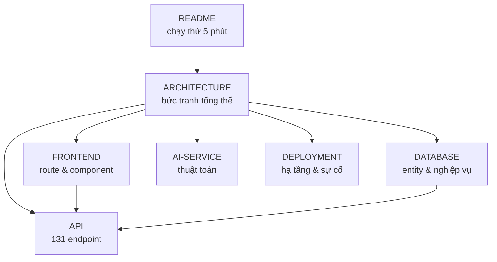

# Tài liệu Turfzone

Bộ tài liệu kỹ thuật của đồ án **Turfzone** (quản lý sân bóng & giải đấu), viết lại từ mã nguồn đang chạy trong monorepo `SoccerHub`.

- Đối chiếu với mã nguồn tại nhánh `main`, commit `11857aa` (2026-10-24), cộng các thay đổi chưa commit ở module CLB (`ClubController`, repository liên quan).
- Tài liệu mô tả **hành vi thực tế của code**, không mô tả ý định thiết kế chưa được cài đặt. Chỗ nào code chưa có, tài liệu ghi rõ là chưa có.

## Đọc gì trước?

| Bạn là | Đọc theo thứ tự |
|---|---|
| Người chấm / người mới | [README](../README.md) → [ARCHITECTURE](./ARCHITECTURE.md) mục 2–4 → chạy `run.bat` |
| Backend | [ARCHITECTURE](./ARCHITECTURE.md) mục 5–6 → [DATABASE](./DATABASE.md) → [API](./API.md) |
| Frontend | [FRONTEND](./FRONTEND.md) → [API](./API.md) mục quy ước chung |
| Làm phần AI | [AI-SERVICE](./AI-SERVICE.md) → [ARCHITECTURE](./ARCHITECTURE.md) mục 4.4 |
| Vận hành / demo | [DEPLOYMENT](./DEPLOYMENT.md) → [README](../README.md) mục tài khoản demo |

## Bộ tài liệu

| Tài liệu | Nội dung chính | Khi nào cần đọc |
|---|---|---|
| [ARCHITECTURE.md](./ARCHITECTURE.md) | 3 dịch vụ + mobile, sơ đồ luồng, mô hình bảo mật, 10 quyết định kiến trúc, nợ kỹ thuật | Cần hiểu bức tranh tổng thể hoặc giải trình thiết kế |
| [API.md](./API.md) | 131 endpoint: method, path, quyền, tham số, body, lỗi, ma trận phân quyền | Gọi API, viết client, kiểm thử |
| [DATABASE.md](./DATABASE.md) | 18 entity + 1 embeddable, ERD, quy tắc nghiệp vụ ở tầng dữ liệu, seed, migration | Thiết kế bảng, sửa logic tính toán |
| [FRONTEND.md](./FRONTEND.md) | Route, tầng service, auth state, 61 component, design system, build | Sửa giao diện, thêm màn hình |
| [AI-SERVICE.md](./AI-SERVICE.md) | Hai endpoint FastAPI, công thức chấm điểm và ghép kèo, tích hợp qua proxy | Chỉnh thuật toán, debug AI |
| [DEPLOYMENT.md](./DEPLOYMENT.md) | Biến môi trường, Railway/Vercel/Render, smoke test, xử lý sự cố | Deploy, demo, cứu production |
| [walkthrough.md](./walkthrough.md) | Bản ghi đợt cập nhật tài liệu: đã tạo gì, kiểm chứng ra sao, phát hiện gì, còn gì chưa xong | Muốn biết tài liệu đáng tin đến đâu |

## Quan hệ giữa các tài liệu

Nguyên tắc: **mỗi sự thật chỉ được viết ở một nơi**, các tài liệu khác trỏ link tới. Ví dụ công thức doanh thu nằm ở `DATABASE.md`, `ARCHITECTURE.md` chỉ nêu vai trò và link sang.

## Quy ước viết tài liệu

1. **Ngôn ngữ**: tiếng Việt có dấu; thuật ngữ kỹ thuật, tên bảng, tên endpoint giữ nguyên tiếng Anh.
2. **Dẫn chứng**: khi mô tả logic, ghi kèm đường dẫn file trong dấu backtick, ví dụ `PitchBookingController.java:1100`. Không mô tả hành vi mà không chỉ ra được nơi cài đặt.
3. **Không bịa**: con số (số endpoint, số entity, số component) phải đếm từ code. Nếu chưa xác minh được thì ghi "chưa xác minh".
4. **Cảnh báo** dùng cú pháp GitHub Alerts: `> [!NOTE]`, `> [!WARNING]`, `> [!IMPORTANT]`.
5. **Cập nhật cùng code**: thay đổi endpoint → sửa `API.md`; thêm entity/cột → sửa `DATABASE.md`; thêm route/component → sửa `FRONTEND.md`. Tài liệu lỗi thời được coi là lỗi.

## Phạm vi chưa bao phủ

- **Mobile app**: chỉ mô tả ở mức tổng quan (một `App.tsx` lớn); không có tài liệu chi tiết từng màn hình.
- **Hạ tầng dạng mã (IaC)**: không có Terraform/Helm; cấu hình chỉ là `railway.json`, `render.yaml`, `nixpacks.toml`, `vercel.json` — đã ghi trong `DEPLOYMENT.md`.
- **Kịch bản kiểm thử**: dự án chưa có test tự động, nên tài liệu chỉ có checklist smoke test tay.
- **Lịch sử quyết định đầy đủ**: `ARCHITECTURE.md` ghi 10 quyết định lớn; các quyết định nhỏ nằm rải trong comment code và `ERRORS.md`.
